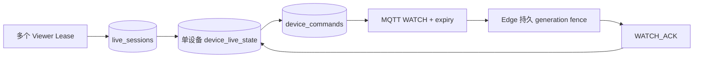

# T0.5 协议与运行时加固

基线 bb059256149a99f8e1482b5e77af9403a70bbe80；开发分支 feature/phase0-5-protocol-hardening。本轮仅加固现有 Go 单体、Edge、MQTT5/TLS、PostgreSQL、Vue 技术栈，没有增加基础设施或现场协议。

## 契约与状态

contracts/model.json 生成 Go/TypeScript、严格 JSON Schema、AsyncAPI。OpenAPI 引用同一模型。每个 Topic 只接受对应 kind 和载荷；WATCH_STOP 不携带坐标或负载。deviceId 是平台不可变全局技术 ID，不使用客户编号代替主键。crane/v1 是尚未部署真实设备的发布前契约，本轮替换旧平铺 Message，不保留双栈。

Edge 每次进程启动先在单写者设备目录中原子增加 bootSeq，再开始 MQTT；随机 bootId 标识本次启动。连接重试不会增加 bootSeq。Cloud 按 bootSeq、sequence 比较，sentAt 不参与顺序。每条 MQTT 连接分配 2^32 序列区间，Will 使用该区间末值；下次连接从更高区间开始。这样固定在 CONNECT 时的 Will 能终止旧连接，延迟 Will 又无法覆盖重连后的 BIRTH。序列上限为 JavaScript 安全整数，耗尽即停止。

Shadow 保留 Presence 与 ReportedState。Presence 保存连接、健康、boot、序列、服务器观测时间和下线原因；ReportedState 保存模式、采集状态、坐标、负载和累计时长。LWT/DEATH 不清空业务快照。DEV 数据是 Mock，不代表机械安全状态。

## LIVE 与回执

Viewer TTL 默认 300 秒，最后 Viewer 的 grace 默认 45 秒。upstream 的 Edge TTL 最多 300 秒，由 Cloud 周期续租。device_commands 是当前 WATCH 的轻量持久待发记录，包含重发所需的原始 Envelope 和交付截止时间。每两秒可重发同 commandId，未收到应用回执不能从 STARTING 变 LIVE。交付窗口为 min(10 秒, upstream TTL)，MQTT Message Expiry 不超过 TTL；命令交付截止时间与执行后的 LIVE 定时器分开。Edge 将 broker 剩余有效期转为本地单调时钟 deadline；payload expiresAt 用于 Cloud 发包和记录，不依赖设备 UTC 校准来决定能否执行。

PostgreSQL 是 desired 权威。BIRTH/Cloud MQTT 重连重新计算 Viewer 需求，并以新 generation START 对账；历史 STOP 被围栏拒绝。Edge 持久保存 generation、leaseId、最近 1024 个命令结果；重启不恢复 LIVE 定时器，必须重新收到有效命令。同一设备目录仅允许一个 Agent 写者，T0.5 不支持多个 Cloud 副本或分布式协调。

## 事件与 Adapter

ALARM/EVENT 进入容量 256 的 spool，Telemetry 不缓存。Linux 写入顺序为临时文件、文件 fsync、rename、目录 fsync。Cloud 提交 PostgreSQL 后发 STORED；ACK 丢失时相同 messageId 重发，唯一键去重并再次 ACK。spool 满明确告警，不覆盖旧消息。Windows 开发环境不提供目录 fsync；Linux 是 Edge 运行目标。

Adapter 只返回 TelemetrySnapshot、AlarmEvent、DeviceHealth 等内部领域数据；Edge Core/Mapper 负责租户、设备身份、启动代次、序列、Topic 和信封。当前只有 Mock Adapter。

## 迁移与观测

00001_baseline.sql 保持不变，00002_runtime_hardening.sql 一次性转换旧匿名 Shadow/告警/事件并增加 upstream、command 表。旧业务快照与 version 保留，旧 Shadow bootSeq 标为 0，等待正式 Agent bootSeq 建立新序。历史遥测原始记录保留，不重发旧协议。迁移失败用事务回滚，已应用迁移后续只做 forward-fix；回退到 Phase0 必须使用升级前备份，不能直接运行旧二进制。

Cloud /metrics 增加 Viewer/upstream、WATCH 发送/回执/过期、事件应用 ACK、MQTT 重连。Edge/模拟器仅在容器 loopback:8083 提供 /metrics，包括 spool depth/full/retries、应用 ACK、重连，不映射宿主端口。开发排查可 compose exec device-simulator wget -qO- http://127.0.0.1:8083/metrics。日志带 deviceId、messageId、commandId、sessionId 或 generation；计数器是进程生命周期值，重启归零。

Will Delay 默认 20 秒、支持 5–60 秒；协议语义见 [OASIS MQTT5 §3.1.3.2.2](https://docs.oasis-open.org/mqtt/mqtt/v5.0/mqtt-v5.0.html)。正常 SIGTERM/SIGINT 尽力先发布 DEATH，再 Normal Disconnect；异常退出用 LWT。

## 交付边界

通过 T0.5 后可审查是否授权 Phase1；不表示生产可用。生产身份、CA 生命周期、备份恢复演练、真实设备适配、容量压测、生产部署尚未实施。Phase0 验收资料保留；本轮不创建 PR/Tag，不合并 main，最终 CI 必须与最终 HEAD 相同。
