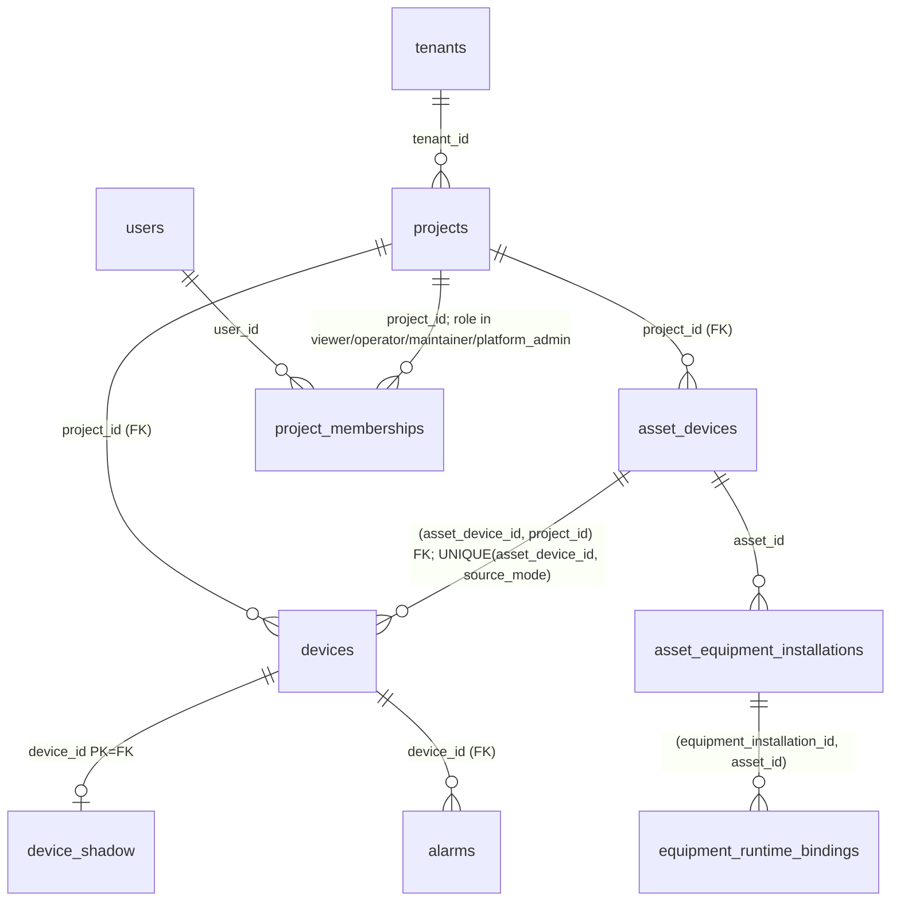

# Homepage H2-0：运营数据契约设计

> 分支 `feature/homepage-operations-center-r1`。H2-0 **只做契约、权限、验证计划与可复现探针**；不新增生产接口、不改数据库迁移、不改后端代码、不部署、不合并 main、不做 G3-D4。
> 事实来源：仓库 `deploy/postgres/migrations/00001–00012`、`internal/inventory/inventory.go`、`internal/identity/*`、`internal/asset/asset.go`、`services/cloud-api/internal/app/api.go`、`services/cloud-api/internal/alarm`、`contracts/model.json`，以及在**空库**上依次执行全部 goose Up 后运行的合成数据探针 `evidence/homepage-h2-0/identity-probe.sql`（输出 `identity-probe.out.txt`，下文以 Q1–Q11 引用）。
> 基础口径沿用 `Homepage-H1-R1-统计范围契约.md`（本文 §2 对其中「合法 0」表述作了更正）。

---

## 0. 结论摘要

1. **AssetMasterData 与 Inventory AssetDevice 是同一张表 `asset_devices`、同一主键**（Q1）。资产中心（`/api/v1/assets`）与首页 Inventory（`/api/v1/assets/devices`）是同一行的两种投影，不存在「两套档案各算一次」的重复——**只要统计以 `asset_devices.id` 为唯一身份**。
2. 真正的重复计数风险在**运行身份**：一台资产可同时有 SIMULATION 与 REAL 两个 `devices` 行（唯一约束是 `(asset_device_id, source_mode)`，Q2），朴素 JOIN 会把 A1 算两次（Q3）。现行 `inventory.Assets` 用 `LIMIT 1` 只取一个运行身份且 **REAL 优先、不论是否在线**（Q4），导致「REAL 离线、SIM 在线」时首页把它算作离线。
3. 四个现存口径缺口（均为事实，H2-1 修复）：
   - `inventory.Projects` 只返回 `lifecycle IS NOT NULL` 的项目，而 `inventory.Assets` 不过滤，**遗留项目下的资产会出现在设备列表但其项目不在项目列表**（Q5）；前端因找不到项目会丢弃这些设备，造成「设备 API 条数 ≠ 首页台数」。
   - `inventory.Assets` 不过滤 `asset_status`，**已退役资产仍计入 Inventory 设备**（Q6）。
   - 告警可来自**无资产归属的运行身份**（Q7），首页按资产聚合时这类告警无处可挂。
   - 告警记录数 ≠ 告警设备数（Q8）；当前告警接口固定 `LIMIT 100`，不能用于任何计数。
4. 权限：`/api/v1/projects`、`/assets/devices` 在 **Go 层**按 `project_memberships` 过滤（SQL 层全量查询后丢弃）；`/devices` 按 membership 预查；`/alarms` 在 SQL 层带 scope（`ListScoped`）。**`platform_admin` 不是全局旁路**，仍需项目 membership（`identity/capability.go`）。现有模型**没有「项目管理员」角色**，任务书中的该角色需要映射或新增（§5）。
5. 时间：Shadow 的 `presence.lastSeenAt` 与 `updatedAt` 都由消息的观测时间写入（`services/cloud-api/internal/shadow/order.go`：`next.UpdatedAt = observed`、`p.LastSeenAt = observed`），即二者都是**观测时间**，离线消息（LWT/DEATH）只更新 `updatedAt` 与 `disconnectedAt`；告警有 `alarms.observed_at`；统计层目前没有 `generatedAt`，前端只有 `fetchedAt`。H0-D2 根因是前端 `sentAt.slice(11,19)` 截取 UTC 字符串（Q11：UTC 16:30 = 上海次日 00:30，日期也会错）。
6. **接口方案推荐方案 2：新增只读 `GET /api/v1/operations/summary`**，理由是计数必须在服务端、在授权与去重之后、不受 `LIMIT 100` 影响地完成，且要提供 `generatedAt` 与分区汇总；方案 1（沿用现有接口 + 后端聚合服务）无法在不改变现有接口语义的前提下给出正确计数（§6）。是否采纳由审查决定，H2-0 不实现。

---

## 1. 数据身份与关联

### 1.1 关联图



### 1.2 实体表

| 实体（任务书名） | 物理表 / 来源 | 主键 | 外键与唯一性 | 授权锚点 | 关联缺失时的展示规则 |
|---|---|---|---|---|---|
| Inventory Project | `projects`（`lifecycle IS NOT NULL` 才是 Inventory 项目） | `id` | `tenant_id → tenants` | `project_memberships.project_id` | 无 `admin_code`：项目可见、计入「全国」、不进入任何省/市范围、地图不定位，显示「无空间位置」 |
| Inventory AssetDevice | `asset_devices`（`/api/v1/assets/devices` 投影） | `id` | `project_id → projects`；`UNIQUE(id, project_id)`；`UNIQUE(project_id, asset_code)`（非空时） | 所属 `project_id` | 无运行身份：状态 = 尚未投运（不是离线、不是 0 运行） |
| AssetMasterData | **同一张 `asset_devices`**（`/api/v1/assets` 投影，含 `asset_status`/`asset_code`/`version` 等） | `id` | 同上 | 同上 | 与 Inventory 是同一行，统计唯一身份 = `asset_devices.id` |
| Runtime Binding（运行身份） | `devices`（`asset_device_id` + `source_mode`） | `id` | `project_id → projects`；`(asset_device_id, project_id) → asset_devices(id, project_id)`（保证运行身份与资产同项目）；`UNIQUE(asset_device_id, source_mode) WHERE asset_device_id IS NOT NULL` | `devices.project_id` | `asset_device_id IS NULL`：孤立运行身份，不计入资产统计；其告警单独计入「无资产归属告警」 |
| （部件级绑定） | `equipment_runtime_bindings` | `id` | `(equipment_installation_id, asset_id)`；一个部件同时仅一条活动绑定 | 经 `asset_id` | 本阶段**不参与**首页统计（目前只用于退役/拆卸守卫，无运行数据写入） |
| Runtime Shadow | `device_shadow` | `device_id`（= `devices.id`） | `device_id → devices` | 经 `devices.project_id` | 有运行身份无 Shadow：离线/状态未知（现行冻结规则） |
| Alarm Envelope | `alarms` | `message_id` | `device_id → devices` | 经 `devices.project_id`（`ListScoped` 已在 SQL 层 JOIN） | 运行身份无资产：计入「无资产归属告警记录」，不计入告警设备 |

### 1.3 重复计数检查

| 场景 | 是否重复 | 证据 | 规则 |
|---|---|---|---|
| 同一台行车同时出现在资产中心和 Inventory | **否**（同一行） | Q1：5 行 5 个 id | 统计身份 = `asset_devices.id` |
| 同一资产同时有 SIM 与 REAL 运行身份 | **朴素 JOIN 会重复** | Q2、Q3：3 行 JOIN、2 个资产 | 设备计数一律 `count(DISTINCT asset_devices.id)`；运行源按资产**选一个代表运行身份**（§2.3），另行按运行身份计「SIM 绑定数 / REAL 绑定数」 |
| 不同项目同名设备（「1号行车」） | 否（不同 id） | Q9 | 名称不是身份；跨项目统计、URL、搜索一律用 id |
| 遗留项目（`lifecycle IS NULL`）下的资产 | 项目不计、资产却被列出 | Q5 | 统计基础集要求**资产所属项目是 Inventory 项目**；H2-1 让两接口口径一致 |
| 已退役资产 | 现行被计入 | Q6 | Inventory 设备 KPI 排除 `RETIRED`；`DRAFT` 计入「登记」但不计入「投运」类指标（§2.1 字典） |

### 1.4 代表运行身份的选择（修正现行 REAL 优先）

现行 `ORDER BY REAL, SIMULATION, TEST LIMIT 1` 在「REAL 已建但离线、SIM 在线」时让资产显示离线（Q4：A1 → EDGE-A1 OFFLINE）。H2 规则：

1. 运行源（`runtimeSource`）= 若存在 REAL 运行身份则为 REAL（**身份优先级不变**：只要接入过真实现场，就不再宣称「仅模拟」）。
2. 连接与状态取**该运行源**的 Shadow；REAL 离线时资产状态 = 离线（不会因为 SIM 在线而显示在线——SIM 永远不能冒充现场）。
3. 同时返回 `simulationBound`（是否另有 SIM 身份）供详情说明。

即：现行选择**结果正确**（REAL 优先），问题仅在于未把 SIM 信息暴露，首页 `simulationBound` 只能看到被选中的那一个。H2-1 在服务端分别计数。

---

## 2. 统计指标字典

### 2.1 范围与「合法 0」

基础集：**授权项目 ∩ Inventory 来源筛选 ∩ 当前行政区**（已显示层级）。状态筛选只作用于设备展示，不改变 KPI 基础计数；聚焦项目/设备不改变任何计数。

> **更正**（相对 H1-R1 初版契约）：「只有成功返回空列表才显示 0」是错误表述。正确规则：**一次完整成功加载之后，任何指标的合法计数都可以为 0**（如告警设备 0、真实运行 0）；**只有未知或失败**才显示「不可用」，加载中显示占位。该更正已同步到 H1-R1 契约与报告（提交 `b457591`）。

「完整」的含义：服务端在同一快照内算完全部指标；任一必需子查询失败则整份 summary 失败（503），**不返回部分计数**（避免「告警 0」其实是告警查询失败）。

### 2.2 指标字典

| 指标 id | 中文名 | 计数对象 | 定义（在基础集内） | 不是什么 | 现行来源 | H2 来源 |
|---|---|---|---|---|---|---|
| `projects` | 项目 | Inventory 项目 | `projects.lifecycle IS NOT NULL` | 不含遗留项目 | 前端计 | summary |
| `assets.registered` | Inventory 设备 | 资产 | `count(DISTINCT a.id)`，`asset_status <> 'RETIRED'` | 不是运行身份数 | 前端计（含退役） | summary |
| `assets.unlocated` | 无空间位置 | 资产 | 所属项目 `admin_code IS NULL` | — | 前端计 | summary |
| `assets.notCommissioned` | 尚未投运 | 资产 | 无任何运行身份 | 不是离线 | 前端计 | summary |
| `runtime.bound.{REAL,SIMULATION,TEST}` | 运行源绑定 | **资产** | 资产拥有该 `source_mode` 的运行身份（一台可同时计入 REAL 与 SIM） | 不是在线数 | 部分（只看到代表身份） | summary |
| `connectivity.{connected,offline,unknown}` | MQTT 连接 | 资产（按代表运行身份） | Shadow `presence.connectivity`；无 Shadow = unknown | 不是作业运行 | 前端计 | summary |
| `operation.{working,idle,unknown}` | 作业运行状态 | 资产 | **暂无契约**：Shadow 无作业状态字段 | — | 前端把 `LIVE/EVENT` 当 RUNNING（**错误**） | H2-1 显示「未接入」，见 §2.4 |
| `acquisition.live` | 实时采集中 | 资产 | `operatingState = LIVE`（数据流开启） | **不是**设备在作业 | — | summary（可选） |
| `alarm.devices` | 告警设备 | 资产（按代表运行身份） | 已连接且 `reported.alarmState = ACTIVE` | 不是告警条数 | 前端计 | summary |
| `alarm.records.window` | 告警记录（时间窗） | 告警消息 | `alarms.observed_at ≥ now()-window`，按资产所属范围 | 不是未处理数 | `/alarms` LIMIT 100 计长度（**不可用于计数**） | summary（带 `window`） |
| `alarm.records.unattributed` | 无资产归属告警 | 告警消息 | 运行身份 `asset_device_id IS NULL`，仅按项目授权 | — | 混在列表中 | summary |
| `events.pending` | 待处理告警/事件 | 事件 | **暂无契约**（无确认/处理状态表） | — | 「未接入」 | 保持「未接入」，不得以告警记录冒充 |
| `regions[]` | 分区汇总 | 资产 | 当前层级下一级行政区的 `registered / alarm.devices` | — | 前端逐区计 | summary |

### 2.3 来源维度的区分（不可混用）

| 维度 | 字段 | 取值 | 回答的问题 |
|---|---|---|---|
| Inventory 登记来源 | `Project.dataSource`（前端） | `real` 登记 / `demo` 演示（仅 Demo 模式） | 这是登记项目还是演示数据？ |
| 运行源 | `devices.source_mode` | REAL / SIMULATION / TEST | 运行数据来自真实现场、模拟器还是测试？ |
| MQTT 连接 | `presence.connectivity` | MQTT_CONNECTED / OFFLINE / UNKNOWN | 设备当前是否连着云端？ |
| 数据采集状态 | `reported.operatingState` | DISCONNECTED / SILENT / LIVE / EVENT / UNKNOWN | 云端在收心跳、实时流还是事件？ |
| 作业运行 | 无 | — | 行车是否在吊运作业？**当前无法回答** |
| 告警状态 | `reported.alarmState` | NONE / ACTIVE / UNKNOWN | 设备当前是否处于告警？ |

### 2.4 LIVE ≠ 作业运行（现行缺陷）

`scene/device-status.ts` 把 `operatingState ∈ {LIVE, EVENT}` 映射为 `RUNNING`，首页「真实运行」KPI 由此计数。但 `LIVE` 是**有人打开实时查看、数据流开启**（`upstreamStatus` / `live_sessions`），`SILENT` 是静默心跳——两者都与行车是否在作业无关。H2-1 规则：

- 在作业状态契约（如 PLC 作业信号）接入前，「真实运行」KPI 改为「REAL 在线」（`runtime.bound.REAL ∩ connectivity.connected`），作业运行显示「未接入」；
- `LIVE` 只作为「实时采集中」展示，绝不计入运行。依据：边缘状态机中 LIVE = 存在未过期的查看租约（`Machine.Watch(ttl≤300s)`），EVENT = 存在未确认事件，二者都与吊运作业无关。
- 此项会改变首页现有文案与 premium 测试的期望，属于 H2-3 前端切换批次（§8）。

---

## 3. REST API 契约草案（只读，未实现）

```http
GET /api/v1/operations/summary?source=all|real&region=<adcode>&alarmWindow=PT24H
Cookie: <web session>
```

- `source`：Inventory 登记来源（API 模式只有 `all`/`real`，`demo` 返回 400）。
- `region`：6 位 adcode；未知 → 404 `{"error":"region_not_found"}`；格式错误 → 400。区域只**收窄**授权数据。
- `alarmWindow`：ISO-8601 时长，允许 `PT1H`…`P7D`，默认 `PT24H`，超出 → 400。
- **不接受** `projectId` 列表参数：范围由会话决定，调用方不能扩大或指定他人项目。
- 状态过滤**不是**参数（状态只影响展示，KPI 不自我过滤）。

响应 200：

```json
{
  "schemaVersion": 1,
  "generatedAt": "2026-11-07T08:00:01.123Z",
  "scope": { "source": "all", "region": 330000, "regionName": "浙江省", "authorizedProjects": 3 },
  "freshness": { "oldestObservedAt": "2026-11-07T07:40:12Z", "newestObservedAt": "2026-11-07T07:59:59Z", "staleAfterSeconds": 2100, "staleAssets": 1 },
  "metrics": {
    "projects": 2,
    "assets": { "registered": 3, "unlocated": 0, "notCommissioned": 1, "retiredExcluded": 1 },
    "runtimeBound": { "REAL": 1, "SIMULATION": 2, "TEST": 0 },
    "connectivity": { "connected": 1, "offline": 1, "unknown": 0 },
    "acquisition": { "live": 0 },
    "operation": { "status": "NOT_AVAILABLE" },
    "alarm": { "devices": 1, "recordsInWindow": 2, "unattributedRecordsInWindow": 0, "window": "PT24H" },
    "pendingEvents": { "status": "NOT_AVAILABLE" }
  },
  "regions": [ { "adcode": 330400, "name": "嘉兴市", "registered": 2, "alarmDevices": 1 } ]
}
```

错误：401 未登录；404 区域不存在（与「无权限」不可区分的项目信息不泄露——区域是公开地理数据，可区分）；503 任一子查询失败（不返回部分数据）。`Cache-Control: no-store`。OpenAPI 变更走 `contracts/model.json` → codegen，与现有流程一致。

**不在 summary 中的**：设备明细列表（仍走 `/assets/devices`，H2-1 修正其退役/遗留项目口径）；告警明细（仍走 `/alarms`，H2-1 增加 `since` 与分页，不再固定 100）。

---

## 4. 时间与新鲜度契约

| 时间 | 含义 | 来源 | 展示 |
|---|---|---|---|
| `observedAt` | 设备状态实际观测时间 | Shadow `presence.lastSeenAt`（最近一条非离线消息的观测时间；`updatedAt` 同为观测时间但离线消息也会更新它）；告警 `alarms.observed_at` | 资产详情「最后观测」；summary `freshness.oldest/newestObservedAt` |
| `generatedAt` | 服务端完成统计的时间（单一快照） | summary 响应 | 页头「统计生成于 …」 |
| `fetchedAt` | 前端最近一次成功拉取时间 | 浏览器 | 页头「最近拉取 …」（H1-R1 已实现） |

规则：

1. 三个时间**互不替代**；前端不得用 `fetchedAt` 或本地时钟冒充 `observedAt`/`generatedAt`，也不得在没有新数据时自行推进任何时间或「呼吸式」变化数字。
2. 展示时区统一为 **Asia/Shanghai，完整 `YYYY-MM-DD HH:mm:ss`**；不得截取 ISO 字符串（H0-D2 根因）。
3. 刷新与过期（依据边缘实现：`edge/agent/runner/runner.go` SILENT 时每 **15 min** 发 HEARTBEAT、每 1 h 发快照；LIVE 由查看租约驱动，`edge/agent/internal/domain/state.go`，TTL ≤ 300 s）：

| 指标类别 | 刷新方式 | 允许延迟 | 过期阈值 | 断网/失败保留 |
|---|---|---|---|---|
| 资产登记类（项目、设备、未投运、无位置） | 页面打开 + 手动刷新 + 每 60 s | 60 s | 5 min 未成功刷新 → 「已过期」 | 保留旧值 + 「已过期」 |
| 连接/告警设备 | 每 15 s（与 Cloud Runtime 合并为同一轮询，H2-3） | 15 s | 单资产 `now - observedAt > 35 min`（边缘 SILENT 心跳 15 min × 2 + 5 min 余量）计为 `staleAssets`；summary 本身 60 s 未成功刷新 → 「已过期」 | 保留旧值 + 「已过期」；过期资产不计入「在线」 |
| 告警记录（时间窗） | 同上 | 15 s | 同上 | 同上 |
| 作业运行 / 待处理事件 | — | — | — | 「未接入」 |

4. 首次加载失败：「不可用」，不显示任何数字（H1-R1 已实现）；完整成功后合法 0 照常显示。
5. 页面隐藏（`visibilitychange`）时暂停轮询，恢复时立即刷新一次；不在后台累积请求。

---

## 5. 项目级权限矩阵

### 5.1 角色映射

现有项目角色（`project_memberships.role`）：`viewer / operator / maintainer / platform_admin`；能力见 `identity/capability.go`。任务书角色映射：

| 任务书角色 | 现有角色 | 说明 |
|---|---|---|
| platform_admin | `platform_admin`（按项目授予） | **不是全局旁路**：没有 membership 的项目同样不可见 |
| 项目管理员 | **无对应角色** | 方案：H2 不新增角色；读统计与 `viewer` 相同。若需「管理成员」能力，属 R4 范围（用户/授权中心），需另立契约 |
| 普通项目用户 | `operator` / `maintainer` | 读统计与 `viewer` 相同；额外能力（watch、维护写）与统计无关 |
| 只读用户 | `viewer` | 读统计 |
| 无授权项目用户 | 无 membership / 已禁用用户 | summary 返回 200 + 全 0 + `authorizedProjects: 0`（这是**合法 0**，前端显示「当前账号没有可见项目」）；所有明细接口 404/空 |

### 5.2 矩阵（读统计只需 `read` 能力）

| 操作 | platform_admin（P1） | 项目管理员 → 见上 | operator/maintainer（P1） | viewer（P1） | 无授权 |
|---|---|---|---|---|---|
| summary（只含 P1） | ✓ | ✓ | ✓ | ✓ | ✓（全 0） |
| summary 含 P2 数据 | ✗ | ✗ | ✗ | ✗ | ✗ |
| `?region=` 仅含 P2 的区域 | 200，计数 0（不泄露 P2 存在） | 同左 | 同左 | 同左 | 同左 |
| `/assets/devices` P2 行 | 不返回 | 不返回 | 不返回 | 不返回 | 不返回 |
| `/devices/{P2 设备}` | 404 | 404 | 404 | 404 | 404 |
| `/alarms?deviceId=<P2 设备>` | 404 | 404 | 404 | 404 | 404 |
| 构造 URL `/overview?project=P2` | 前端提示「不存在或不在授权范围」（已实现），summary 不受影响 | 同左 | 同左 | 同左 | 同左 |
| 禁用用户（`users.enabled=false`） | 401/空 | — | — | — | — |

### 5.3 必须由服务端保证（不依赖前端）

- summary SQL 以 `project_memberships JOIN users(enabled)` 作为**第一层 CTE**，所有计数从该 CTE 派生（与 `alarm.ListScoped`「先 scope 再 LIMIT」一致）。
- 区域过滤在授权 CTE **之后**应用，只能收窄。
- 授权查询失败 → 503（与现有 `authorization unavailable` 一致），绝不降级为「无过滤」。
- 同名设备：一切按 id；summary 不返回名称聚合。

---

## 6. 接口方案对比

| 维度 | 方案 1：沿用 `/projects` `/assets/devices` `/devices` `/alarms`，后端加一致的聚合服务（各接口内部复用） | 方案 2：新增 `GET /api/v1/operations/summary` |
|---|---|---|
| 计数正确性 | 前端仍需把 4 个列表 JOIN 后计数；告警只有最近 100 条，**无法得到时间窗记录数**；SIM+REAL 只返回代表身份，无法计 `runtimeBound` | 服务端在一个快照内计数，去重与授权一次完成 |
| 授权复用 | 已有（Go 层过滤） | 复用 `identity.Grants` / membership CTE；与 `ListScoped` 同模式 |
| 查询性能 / DB 负载 | 每次首页 4 个全量列表（资产数 N 线性传输，现行 SQL 先全量后 Go 过滤） | 1 次聚合查询，返回 O(区域数)；需索引 `devices(asset_device_id)`、`alarms(device_id, observed_at)`（后者为新增，H2-1 迁移） |
| 实时性 | 同现状 | 可带 `generatedAt` 与 `freshness`；15 s 轮询负载小 |
| 可扩展性 | 新指标需改前端 + 可能改多个列表接口 | 新指标加字段（`schemaVersion` 递增，只加不改） |
| 版本管理 | 改变现有列表接口语义（如过滤退役资产）会影响资产中心、Inventory 页与 B4 测试 | 新接口独立版本；现有接口只做**口径修正**（退役/遗留项目），可单独评估 |
| 与 B4 测试兼容 | 改列表接口语义有回归风险（B4 asset-crud/rbac 依赖资产列表） | 不触碰 B4 资产 CRUD 路径；新增独立 Go+PG 测试 |
| 复杂度 | 低（不加接口），但正确性做不到 | 中：一个新只读接口 + 一个索引迁移 |

**推荐方案 2**。收益明确：时间窗告警记录数、按运行源的资产计数、`generatedAt`/新鲜度、去重与授权一次完成，这四项方案 1 无法在不改变现有接口语义的情况下提供。方案 2 不替代明细接口；首页明细仍用现有接口（经 H2-1 口径修正）。

---

## 7. 典型业务场景与失败反证（H2-1/H2-2 必须实现为测试）

Go + 真实 PostgreSQL（httptest + 完整中间件，沿用 `api_security_test.go` 的 `securityFixture`）：

| # | 场景 | 断言 | 反证（撤销后应失败的实现） |
|---|---|---|---|
| S1 | 资产同时有 SIM（在线、告警）与 REAL（离线） | `registered=1`、`runtimeBound.REAL=1, SIMULATION=1`、`connectivity.offline=1`、`alarm.devices=0` | 朴素 JOIN 计数（registered=2）；按 SIM 判在线 |
| S2 | 资产中心新建资产（同表） | summary `registered` +1，且只 +1 | 把 `/assets` 与 `/assets/devices` 相加 |
| S3 | 退役资产 | 不计入 `registered`，计入 `retiredExcluded` | 不过滤 `asset_status` |
| S4 | 遗留项目（`lifecycle IS NULL`）下的资产 | 不计入任何指标 | 只过滤项目不过滤资产 |
| S5 | 告警来自无资产运行身份 | 计入 `unattributedRecordsInWindow`，不计入 `alarm.devices` | 丢弃或计入资产告警 |
| S6 | 150 条告警记录 | `recordsInWindow=150` | 复用 `LIMIT 100` |
| S7 | P1 viewer 请求 summary，P2 有告警 | 计数只含 P1；`?region=` P2 所在区域 → 0 | 前端过滤 / 区域在授权前应用 |
| S8 | 无 membership 用户 | 200 + 全 0 + `authorizedProjects=0` | 返回全量或 500 |
| S9 | `platform_admin` 只有 P1 membership | 看不到 P2 | 把 platform_admin 当全局 |
| S10 | 禁用用户 | 401 / 无数据 | 只查 membership 不查 enabled |
| S11 | 子查询失败（如 alarms 表锁超时，测试中 `SET statement_timeout`） | 503，无部分数据 | 返回部分计数 |
| S12 | P1 与 P2 都有「1号行车」 | 各自计数，无合并 | 按名称聚合 |
| S13 | `region=999999` / `region=abc` / `alarmWindow=P30D` | 404 / 400 / 400 | 静默忽略返回全国 |
| S14 | 告警 `observed_at` = UTC 16:30 | 前端显示 `2026-11-07 00:30:00`（上海、含日期） | `slice(11,19)` |
| S15 | Shadow `lastSeenAt` 早于 35 min 且 `connectivity=MQTT_CONNECTED` | 计入 `staleAssets`，不计入 connected | 忽略过期；或误用 90 s 阈值把正常静默设备全部判过期（反向反证：`lastSeenAt` 早 20 min 仍计 connected） |

浏览器（premium，mock summary）：首次 503 不可用；完整成功后合法 0；过期标记；三个时间分别显示；LIVE 不计入运行；`region` 与标签同步（沿用 H1-R1 用例）。

---

## 8. 遗留缺陷 H0-D1 / H0-D2 正式修复测试

| 缺陷 | 现状 | 修复（H2-3 前端批次） | 测试变化 |
|---|---|---|---|
| H0-D1 空省份计入省份数 | `data/index.ts aggregate()`：`new Set(items.map(p => p.province)).size`，`''` 计为 1；`apps/web-console/tests/data.test.ts` 中 `it.fails` | 过滤空白省份：`new Set(items.map(p => p.province.trim()).filter(Boolean)).size` | 删除 `.fails`，变为常规必过；增补「全部空省份 = 0」「一个空 + 一个浙江 = 1」「前后空格视为同一省」 |
| H0-D2 告警时间 UTC | `scene/provider.ts`：`time: a.sentAt.slice(11, 19)`；`homepage-h0-defects.spec.ts` 中 `test.fail` | 用 `formatCloudTime(a.sentAt)`（已是 Asia/Shanghai），事件条显示完整日期时间或「MM-DD HH:mm:ss」 | 删除 `test.fail`；期望由 `16:49:15` 改为含日期的上海时间；增补跨日用例（UTC `16:30Z` → 次日 `00:30`），单测覆盖 `formatCloudTime` 跨日 |

两项都**只在 H2-3 实施时**删除 expected-fail；H2-0 不改动这两处代码与标记。

---

## 9. 与现有数据库、接口、测试的兼容性

| 对象 | 影响 | 处理 |
|---|---|---|
| 迁移 | 方案 2 需新增 `CREATE INDEX alarms_device_observed ON alarms(device_id, observed_at DESC)`（00013，可在线、可回滚：Down 为 DROP INDEX） | 不改现有表结构；迁移治理测试（`governance_test.go`）覆盖 up/down |
| `/api/v1/assets/devices` | 口径修正：排除 `RETIRED`、只返回 Inventory 项目下的资产 | 影响首页、Inventory 设备页；`internal/inventory/database_test.go` 与 cloud e2e 期望需同步（示例数据无退役/遗留，**现有期望数不变**） |
| `/api/v1/alarms` | 增加可选 `since` 与分页，默认行为（最近 100）保持 | 向后兼容 |
| `/api/v1/assets`（资产中心） | 不变 | B4 asset-crud / rbac / visual 不受影响 |
| `device-status.ts` RUNNING 规则 | H2-3 改为不把 LIVE 当运行 | 影响 premium「真实运行」断言与 demo 文案；demo 数据本身是演示运行态，保留「演示运行中」标签 |
| H1-R1 前端 | summary 接入后，`scopedDevices` 计数改由 summary 提供；Inspector 明细仍用列表 | 保留 H1-R1 全部浏览器用例，替换数据源后应全部通过 |
| CI | 新增 Go 测试纳入 `r2-db-test`（拒绝 SKIP）与 `a1-security` | 不改 job 结构 |

探针输出（Q1–Q11）见 `evidence/homepage-h2-0/identity-probe.out.txt`；本地以便携 PostgreSQL 14 在空库执行全部 goose Up（00001–00012）后运行，合成数据，无生产数据。

---

## 10. 分批实施与回滚计划（H2-0 审查通过后才开始）

| 批次 | 内容 | 验收 | 回滚 |
|---|---|---|---|
| **H2-1** 后端口径与契约 | `contracts/model.json` 增加 `OperationsSummary`；`inventory.Assets` 排除退役与遗留项目资产；`/alarms` 增加 `since`/分页；迁移 00013 索引 | Go+PG：S2–S6、S12；契约 codegen `--check`；现有 inventory/asset/app 测试全绿 | revert 提交；00013 Down 删除索引；无数据变更 |
| **H2-2** summary 接口与权限 | `GET /api/v1/operations/summary`（只读，membership CTE 起始） | Go+PG httptest：S1、S7–S11、S13、S15；`a1-security` 增加越权用例；B4 套件不变 | 路由开关：未注册即 404，前端回退到 H1-R1 计算 |
| **H2-3** 前端切换与遗留缺陷 | 首页 KPI/分区改用 summary；三时间展示；LIVE ≠ 运行；H0-D1/D2 修复并删除 expected-fail；Cloud Runtime 与首页合并轮询 | premium/demo/cloud 全绿；H1-R1 22 条 + H0 10 条；S14 浏览器用例；五分辨率截图 | 前端 feature flag `VITE_OPERATIONS_SUMMARY=0` 回到 H1-R1 前端计算 |
| **H2-4** 收口 | 文档、证据、同 SHA 九 Job 全绿 | 独立审查 | — |

每批：本地提交 → OWNER 推送 → 同 SHA 九 Job → 独立审查 → 下一批。不部署、不合并 main。

---

## 11. 待审查决策

1. 是否采纳方案 2（新增 summary 接口 + 00013 索引）。
2. 「项目管理员」是否需要新角色（建议否，H2 统计与 viewer 相同；成员管理归 R4）。
3. 「真实运行」KPI 在作业状态契约到位前改为「REAL 在线」并把作业运行标为「未接入」。
4. 单资产过期阈值 35 min（SILENT 心跳 15 min × 2 + 余量；心跳周期若调整须同步）与告警时间窗默认 24 h。
5. Inventory 设备 KPI 排除退役资产、`DRAFT` 计入登记。
