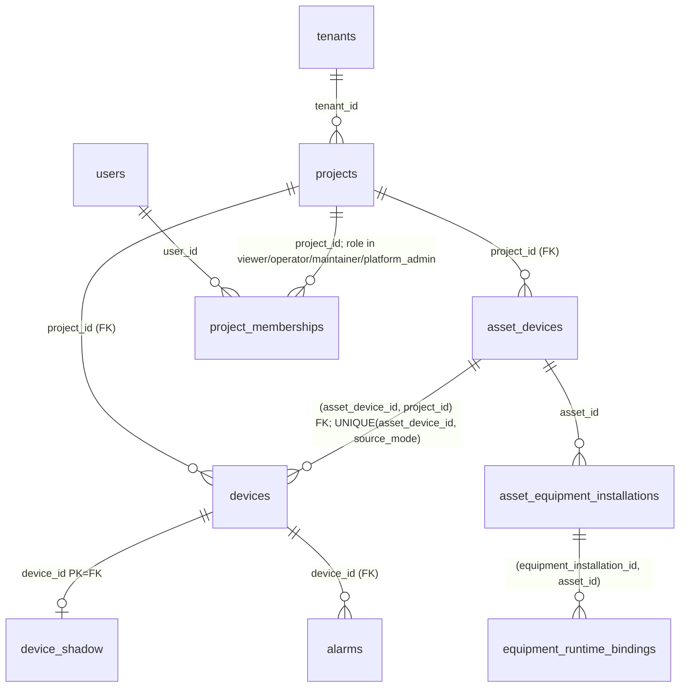

# Homepage H2-0-R2：运营数据契约（冻结稿）

> 分支 `feature/homepage-operations-center-r1`。本文是 H2-0 的修订版（H2-0-R2，在 R1 上做最小修订）。契约部分**只做设计、SQL/OpenAPI 草案、迁移决策与可复现探针**：没有新增生产 summary 接口，没有新增 00013 迁移，没有修改 main 或部署，没有启动 G3-D4。唯一的后端代码改动是已获准的 H2-1A Inventory 口径修正（§10）。
> 审查结论（输入）：原则上批准「新增只读运营统计接口」方向；H2-1 实施未获准。
> **证据性质**：本文所有数字都来自**合成数据**探针，不是生产数据实测。探针在本地便携 PostgreSQL 14 的空库中依次执行 `00001–00012` 全部 goose Up 后运行；脚本与原始输出位于 `evidence/homepage-h2-0/`：
> - `identity-probe.sql` / `.out.txt`：Q1–Q11（H2-0 初版，保留不改）；
> - `summary-draft.sql` + `summary-probe.sql` / `.out.txt`：草案 SQL 的正确性探针 R1–R6；
> - `snapshot-probe.sh` / `.out.txt`：快照一致性反证；
> - `alarm-index-explain.sh`、`alarm-index-cic.sh` / `alarm-index-explain.out.txt`：索引 EXPLAIN ANALYZE 与 `CREATE INDEX CONCURRENTLY` 行为。
> 基础口径沿用 `Homepage-H1-R1-统计范围契约.md`。

---

## 0-R2. 最小修订（相对 H2-0-R1 `d1b60f5`）

| 审查项 | 修订位置 |
|---|---|
| A 时间语义：区分 sampledAt / generatedAt / fetchedAt；单 SQL 只保证读一致，sampledAt 不等于 MVCC 快照时刻 | §3.3、§4.1 |
| B DRAFT / ACTIVE / OUT_OF_SERVICE / RETIRED 行为与「待复核」 | §2.6 |
| C 告警记录「运行源 × 资产归属」互斥分组，unattributed 不再作为额外计数 | §2.5、§3.4 |
| D OpenAPI 核心字段 required、缺失不当作 0；`source` 参数去留 | §3.4 |
| E 迁移治理：`currentVersion()` 用 `max(version_id)` 的问题与 00013 测试方式 | §6.3 |
| H2-1A 实施状态 | §10 |

合成探针（`summary-draft.sql`、`summary-probe.*`）已同步：新增 A8（DRAFT + REAL 新鲜连接）、A9（OUT_OF_SERVICE + REAL 新鲜连接 + 告警）；结果中 `realPendingReview = 2`，`realConnected` 与全部告警设备数只计 ACTIVE；六个告警单元格之和 = `recordsTotal`。

## 0. 修订摘要（相对 H2-0 初版 `4d45620`）

| 审查项 | 修订 |
|---|---|
| A 资产与运行身份 | 四层模型：资产主数据 / 全部绑定身份 / 代表运行身份 / 运行 Shadow；资产去重，绑定按运行源分别计数；REAL 存在时 SIM 在线不得覆盖 REAL 离线（§1.4） |
| B LIVE / REAL 在线 | 新增 `realConnected`（REAL 身份 ∩ MQTT 已连接 ∩ 观测新鲜 ∩ 资产去重；SIM/TEST 不参与）；LIVE = 实时采集中；作业运行 = `NOT_AVAILABLE`；未来作业状态走适配层，不以 PLC 为前提（§2.4） |
| C 同一快照 | 采用**单 SQL + 授权 CTE**；多语句方案必须 `REPEATABLE READ READ ONLY`；反证：READ COMMITTED 两语句出现 `assets=1 / boundREAL=2` 的不一致（§3.3） |
| D 过期与时间 | 35 min 改为**可配置**第一版默认值；补齐断线、过期、无观测时间、未来时间、时钟漂移、迟到消息规则；24 h 窗口定义取样时刻与半开区间（§4） |
| E 告警 | 当前告警设备（按运行源）/ 时间窗记录（按运行源）/ 无资产归属 / 待处理事件分离；禁止用 `/alarms` 最近 100 条推算；SIM 告警计入「全部来源」记录并标注（§2.5） |
| F 00013 | 以 EXPLAIN ANALYZE 为依据；只建 `(device_id, observed_at DESC)` 一个索引；`CONCURRENTLY` 需 goose `NO TRANSACTION`；`IF NOT EXISTS` 会跳过 INVALID 索引——必须先查有效性；不破坏 00012 前向保护（§6） |
| G 权限 | 不新增项目管理员角色；授权 CTE 在前、区域在后；补 platform_admin 仅 P1、禁用用户、授权查询失败、未知区域、空授权、同名跨项目（§5） |
| H Inventory 业务状态 | 退役不计 KPI 但资产中心保留档案；DRAFT 计登记、不计在线；遗留 `lifecycle IS NULL` 不进基础集；设备清单 / 首页 KPI / 项目设备数三处同口径（§2.6） |

---

## 1. 数据身份与关联

### 1.1 关联图



### 1.2 实体表

| 实体 | 物理表 / 来源 | 主键 | 外键与唯一性 | 授权锚点 | 关联缺失时的展示规则 |
|---|---|---|---|---|---|
| Inventory Project | `projects`，`lifecycle IS NOT NULL` | `id` | `tenant_id → tenants` | `project_memberships.project_id` | 无 `admin_code`：计入全国，不进入任何省/市，地图不定位 |
| 资产主数据（AssetMasterData = Inventory AssetDevice） | **同一张 `asset_devices`**（Q1） | `id` | `project_id → projects`；`UNIQUE(id, project_id)`；`UNIQUE(project_id, asset_code)` | 所属项目 | 无运行身份 → 尚未投运 |
| 运行身份（Runtime Binding） | `devices` | `id` | `(asset_device_id, project_id) → asset_devices(id, project_id)`；`UNIQUE(asset_device_id, source_mode)` | `devices.project_id` | `asset_device_id IS NULL` → 孤立运行身份，告警计入「无资产归属」 |
| 部件级绑定 | `equipment_runtime_bindings` | `id` | `(equipment_installation_id, asset_id)` | 经 `asset_id` | 本阶段不参与首页统计 |
| 运行 Shadow | `device_shadow` | `device_id` | `→ devices` | 经 `devices.project_id` | 有运行身份无 Shadow → 状态未知（不是在线） |
| Alarm Envelope | `alarms` | `message_id` | `device_id → devices` | 经 `devices.project_id` | 见 §2.5 |

### 1.3 重复计数检查（Q1–Q9，合成数据）

| 场景 | 是否重复 | 证据 | 规则 |
|---|---|---|---|
| 同一行车同时出现在资产中心与 Inventory | 否（同一行） | Q1 | 资产身份 = `asset_devices.id` |
| 同一资产有 SIM + REAL 两个运行身份 | 朴素 JOIN 重复 | Q2、Q3 | 资产计数 `count(DISTINCT a.id)`；绑定按运行源分别计 |
| 不同项目同名「1号行车」 | 否 | Q9 | 一律按 id |
| 遗留项目资产 | 现行被列出 | Q5 | 不进入基础集 |
| 退役资产 | 现行被计入 | Q6 | 不计 KPI，资产中心保留 |

### 1.4 四层身份模型与优先规则

| 层 | 是什么 | 计数方式 |
|---|---|---|
| 资产主数据 | `asset_devices` 一行 | 资产去重，所有资产类 KPI 的分母 |
| 全部绑定身份 | 该资产的全部 `devices` 行（REAL/SIM/TEST 各至多一个） | `boundREAL/boundSIMULATION/boundTEST`：拥有该运行源绑定的**资产数**（一台可同时计入多个） |
| 代表运行身份 | 用于资产卡片/列表「当前状态」的那一个身份：**有 REAL 则 REAL**，否则 SIM，否则 TEST | 每资产唯一 |
| 运行 Shadow | 每个运行身份自己的 Shadow | 只在该身份的语义下使用 |

规则：

1. 存在 REAL 绑定的资产，其「现场状态」只由 REAL 身份决定。REAL 离线时，即使 SIM 在线且告警，资产的现场状态仍是离线，**不计入 `realConnected`**（合成探针 R1：A1 REAL 显式离线 + SIM 在线告警 → `realConnected` 不含 A1）。
2. SIM/TEST 的在线与告警只在「SIM/TEST 来源」指标里出现，并在界面上标注「模拟/测试」，不得进入任何「现场」指标。
3. 现行 `inventory.Assets` 的 `LIMIT 1` 选择结果与「代表运行身份」一致，但只暴露了一个身份；H2-1 由服务端分别给出全部绑定计数。

---

## 2. 指标字典

### 2.1 范围与合法 0

基础集 = **授权项目 ∩ Inventory 项目（`lifecycle IS NOT NULL`）∩ 来源筛选 ∩ 当前行政区**；资产再排除 `RETIRED`。状态筛选只影响展示；聚焦不改变计数。
一次完整成功的快照内，任何指标的合法计数都可以为 0；只有未知或失败才不可用。任一必需查询失败 → 整份 503，不返回部分统计。

### 2.2 资产与运行

| id | 中文名 | 定义 | 不是什么 |
|---|---|---|---|
| `projects` | 项目 | 基础集项目数 | 不含遗留项目 |
| `assets.registered` | Inventory 设备 | 基础集资产数（含 DRAFT，不含 RETIRED） | 不是运行身份数 |
| `assets.draft` | 草稿登记 | `asset_status = DRAFT` | 不是在线 |
| `assets.noRuntime` | 尚未投运 | 无任何运行身份 | 不是离线 |
| `assets.unlocated` | 无空间位置 | 项目 `admin_code IS NULL` | — |
| `bound.{REAL,SIMULATION,TEST}` | 运行源绑定 | 拥有该运行源绑定的资产数 | 不是在线数 |
| **`realConnected`** | 现场在线 | 资产 `asset_status = ACTIVE`，存在 REAL 身份，且该身份 `connectivity = MQTT_CONNECTED`，且 `observedAt ∈ (sampledAt − staleAfter, sampledAt + maxSkew]`；按资产去重；SIM/TEST 不参与 | 不是作业运行；不是「LIVE」 |
| `realPendingReview` | 待复核 | DRAFT / OUT_OF_SERVICE 资产存在新鲜 REAL 连接 | 不计在线 |
| `realStale` | 现场状态过期 | REAL 身份连接标志为已连接，但 `observedAt` 早于 `sampledAt − staleAfter` 或晚于 `sampledAt + maxSkew` | 不计入在线 |
| `realUnknownTime` | 观测时间缺失 | REAL 身份显示已连接但没有 `lastSeenAt` | 不计入在线 |
| `realOffline` | 现场离线 | REAL 身份 `connectivity = OFFLINE`（收到 LWT/DEATH 立即生效） | — |
| `acquisition.live` | 实时采集中 | `realConnected` 且 `operatingState = LIVE` | **不是**作业运行 |
| `operation` | 作业运行 | `NOT_AVAILABLE`（无可靠输入） | — |

### 2.3 来源维度（不可混用）

| 维度 | 字段 | 回答的问题 |
|---|---|---|
| Inventory 登记来源 | 项目 `dataSource`（Demo 才有 demo） | 登记项目还是演示数据 |
| 运行源 | `devices.source_mode` REAL/SIMULATION/TEST | 数据来自现场、模拟器还是测试 |
| MQTT 连接 | `presence.connectivity` | 是否连着云端 |
| 数据采集状态 | `reported.operatingState` SILENT/LIVE/EVENT… | 云端在收心跳、实时流还是事件 |
| 作业运行 | 无 | 当前无法回答 |
| 告警状态 | `reported.alarmState` | 设备当前是否告警 |

### 2.4 LIVE 与作业运行

边缘状态机（`edge/agent/internal/domain/state.go`）：`LIVE` = 存在未过期的查看租约（`Watch(ttl ≤ 300 s)`），`EVENT` = 存在未确认事件，`SILENT` = 静默心跳。三者都描述**数据采集**，与吊运作业无关。因此：

- 首页「真实运行」KPI 改为 `realConnected`（文案「现场在线」），`acquisition.live` 作为附注「实时采集中 N 台」；
- 作业运行一律 `NOT_AVAILABLE` / 「未接入」；
- 未来作业状态输入以**运行数据适配层**提供统一的 `operation.state` 与 `operation.observedAt`，来源可以是控制板 I/O、独立传感器（电流、编码器、载荷）或 PLC，任何一种都不是前提；适配层与 Shadow 的连接/采集语义分离，不复用 `operatingState`。

### 2.5 告警语义

| id | 中文名 | 定义 | 界面标注 |
|---|---|---|---|
| `alarm.devices.real` | 现场告警设备 | `realConnected` 且 REAL 身份 `alarmState = ACTIVE` | 主 KPI |
| `alarm.devices.simulation` / `.test` | 模拟/测试告警设备 | 对应身份新鲜在线且 `ACTIVE` | 「模拟」「测试」角标，不进主 KPI |
| `alarm.records.cells[source][attribution]` | 时间窗告警记录 | 窗口内 `alarms` 记录按 **运行源（REAL/SIMULATION/TEST）× 资产归属（attributed/unattributed）** 分到 6 个**互斥**单元格；每条记录恰好属于一个单元格 | 合计 `recordsTotal` = 6 格之和；「全部来源」= 合计，界面逐格列出；SIM/TEST 进入合计但带角标 |
| （派生）`unattributed` | 无资产归属 | = 三个运行源的 `unattributed` 单元格之和，是合计的**子集**，不得再与来源合计相加 | 单独一行，注明「已含在合计中」 |
| `alarm.records.futureSkew` | 时间异常记录 | `observed_at ≥ sampledAt + maxSkew` | 不进窗口计数，单独提示 |
| `events.pending` | 待处理告警/事件 | `NOT_AVAILABLE`（无确认/处理状态表） | 「未接入」 |

- 告警设备只计 `ACTIVE` 资产（与 `realConnected` 同规则）；DRAFT / OUT_OF_SERVICE 资产上的告警进入「待复核」。
- 告警设备是**当前状态**（Shadow），告警记录是**历史消息**（`alarms`），两者不可相减或互推。
- `/api/v1/alarms` 仍只用于展示最近记录列表，**禁止**用其返回条数推算任何总数（现行固定 `LIMIT 100`）。
- 退役资产的记录与遗留项目的记录不计入（合成探针 R1：`w-retired`、`w-legacy` 未计入）。

### 2.6 Inventory 业务状态与三处口径一致

| 状态 | Inventory 设备 KPI | 资产中心 `/api/v1/assets` | 运营在线类指标 |
|---|---|---|---|
| ACTIVE | 计入 | 显示 | 按运行身份判定，可计入 `realConnected` 与告警设备 |
| OUT_OF_SERVICE | 计入（`assets.outOfService` 单列） | 显示 | **不计入** `realConnected` 与告警设备；若存在新鲜 REAL 连接 → `realPendingReview`（业务状态与现场连接矛盾，需复核） |
| DRAFT | 计入（`assets.draft` 单列） | 显示 | **默认不计入**现场在线与告警设备；若存在新鲜 REAL 连接 → `realPendingReview` |
| RETIRED | **不计入** | **继续保留历史档案** | 不计入 |
| 遗留项目（`lifecycle IS NULL`）下资产 | 不计入 | 照常（资产中心按自身授权） | 不计入 |

「待复核」不是在线，也不是离线：它表示资产主数据（草稿/停用）与运行事实（真实现场已连接）不一致，界面单列提示，由资产管理员核对业务状态。合成探针 A8（DRAFT）、A9（OUT_OF_SERVICE + 告警）均计入 `realPendingReview`，不计入 `realConnected` 与 `alarm.devices`。

三处一致：**首页 KPI `assets.registered` = `/assets/devices` 列表条数（同范围）= 各项目 `assetDeviceCount` 之和**。现行 `inventory.Projects.assetDeviceCount` 用 `count(*)` 未排除 RETIRED，H2-1A 与列表同步修正。

---

## 3. SQL 与 OpenAPI 草案

### 3.1 草案 SQL

完整草案：`evidence/homepage-h2-0/summary-draft.sql`（**草案，不是生产代码**）。结构：

```
grants          (授权：users.enabled ∧ project_memberships ∧ 读能力角色)
 → scoped_projects (Inventory 项目 ∧ 区域收窄 —— 区域永远在授权之后)
 → assets          (asset_devices，排除 RETIRED)
 → bindings        (全部运行身份 + Shadow 字段)
 → fresh           (以同一个 sampledAt 判定新鲜)
 → per_asset       (每资产一行：has_real / real_connected / real_stale / *_alarm …)
 → alarm_window    (半开窗口 [start, sampledAt)，经 scoped_projects 授权)
 → 单个 json_build_object
```

草案覆盖资产、绑定、现场在线/过期/时间未知、采集、告警设备与时间窗记录；`real.offline`、`assets.unlocated` 与 `regions[]` 分区汇总在 H2-1C 按同一 CTE 补齐。

参数：`$1 userId`、`$2 source`（草案遗留，正式实现删除，见 §3.4）、`$3 region`（仅用于回显）、`$4 windowStart`、`$5 sampledAt`、`$6 staleAfterSeconds`、`$7 regionAdminCodes int[]`（服务端用 geo-manifest 把区域展开为后代 admin_code；行政区层级不在数据库中，因此由服务端提供，且只用于收窄）。

### 3.2 合成数据探针结果（`summary-probe.out.txt`）

夹具：P1（授权，浙江）有 A1（REAL 显式离线 + SIM 在线告警）、A2（REAL 新鲜在线、LIVE、告警）、A3（REAL 标志在线但观测 1 h 前）、A4（DRAFT 无运行身份）、A5（RETIRED 且 REAL 在线告警）、A6（REAL 时间戳超前 1 h）、A7（REAL 在线无观测时间）、孤立 TEST 运行身份告警；P2（未授权，广东）B1 同名「1号行车」在线告警；P3 无位置；PL 遗留项目。`sampledAt = 2026-11-07T08:00:00Z`，窗口 `[2026-11-06T08:00Z, 08:00Z)`，`staleAfter = 2100 s`。

| 用例 | 结果（摘录） | 说明 |
|---|---|---|
| R1 platform_admin（P1+P3+PL），全国 | `projects 2`、`registered 7`、`draft 1`、`noRuntime 2`、`boundREAL 5`、`realConnected 1`、`realStale 2`、`realUnknownTime 1`、`alarmDevicesReal 1`、`alarmDevicesSim 1`、`records {REAL 1, SIMULATION 1, TEST 1}`、`unattributed 1`、`futureSkew 1` | 只有 A2 现场在线；A1 SIM 在线不覆盖 REAL 离线；A3、A6 过期；A7 时间未知；A5 退役不计；PL 遗留不计；P2 不可见；窗口起点含、终点不含 |
| R2 同上，`region=330000` | `projects 1`、`registered 6` | 无位置 P3 退出省级范围 |
| R3 同上，`region=440000`（只有未授权 P2） | 全 0 | 区域不泄露未授权项目 |
| R4 无 membership | 全 0 | 合法 0 |
| R5 禁用用户（有 P1 membership） | 全 0 | `users.enabled` 生效 |
| R6 viewer，`staleAfter = 600 s` | `realConnected 0`、`realStale 3` | 阈值可配置，A2（10 min 前）随之过期 |

### 3.3 一致快照（`snapshot-probe.out.txt`）

| 方式 | 读者在两次扫描之间有写者提交 | 结论 |
|---|---|---|
| READ COMMITTED，两条语句 | `assets=1`、`boundREAL=2` | **不一致**：绑定数大于资产数 |
| REPEATABLE READ READ ONLY，两条语句 | `assets=2`、`boundREAL=2` | 一致（同一快照） |
| 单条语句（READ COMMITTED） | `assets=3`、`boundREAL=3` | 一致（语句级快照） |

决策：

1. **采用单 SQL + 授权 CTE**（§3.1），整份 summary 在一条语句的快照内计算。
2. 若实现中必须拆成多条语句（例如分区汇总单独查询），所有语句必须在 `BEGIN ISOLATION LEVEL REPEATABLE READ READ ONLY` 的同一事务中执行，并设置 `statement_timeout`。
3. 任一查询失败 → 回滚 → HTTP 503 `{"error":"summary_unavailable"}`，不返回任何计数。
4. 时间（H2-0-R2 更正）：
   - `sampledAt`：服务端在执行统计 SQL **之前**取一次的时刻，作为参数传入，**只作为**窗口边界与新鲜度判断的时间基准；
   - 单条 SQL 保证的是**数据库读一致性**（同一 MVCC 语句快照），快照建立时刻在 `sampledAt` 之后若干毫秒，**不声称** `sampledAt` 等于快照时刻；在 `sampledAt` 与快照之间提交的数据会被读到——它们的 `observed_at` 晚于 `sampledAt`，告警会落入 `futureSkew` 之外的 `≥ sampledAt` 区间而不进当前窗口，Shadow 新鲜度判断以 `maxSkew` 容忍；
   - `generatedAt`：服务端完成查询、组装响应时的时刻（≥ `sampledAt`），用于前端显示「统计生成于」；
   - `fetchedAt`：前端收到成功响应的时刻；
   - 响应同时返回 `sampledAt` 与 `generatedAt`，二者不得互相替代。
5. Go 层的内存 Shadow 缓存（`device.Store`）**不得**参与 summary；summary 只读 PostgreSQL 的 `device_shadow`，保证与资产、告警同快照。

### 3.4 OpenAPI 草案

```yaml
/api/v1/operations/summary:
  get:
    operationId: getOperationsSummary
    security: [{ webSession: [] }]
    parameters:
      - { name: region, in: query, schema: { type: string, pattern: '^[0-9]{6}$' } }
      - { name: alarmWindow, in: query, schema: { type: string, enum: [PT1H, PT6H, PT24H, P7D], default: PT24H } }
    responses:
      '200': { content: { application/json: { schema: { $ref: '#/components/schemas/OperationsSummary' } } } }
      '400': { description: 参数格式错误 }
      '401': { description: 未登录 }
      '404': { description: 区域不存在（region_not_found） }
      '503': { description: 任一必需查询失败（summary_unavailable）或授权不可用 }
components:
  schemas:
    Count: { type: integer, minimum: 0 }
    SourceCounts:
      type: object
      additionalProperties: false
      required: [REAL, SIMULATION, TEST]
      properties: { REAL: { $ref: Count }, SIMULATION: { $ref: Count }, TEST: { $ref: Count } }
    AttributionCell:
      type: object
      additionalProperties: false
      required: [attributed, unattributed]
      properties: { attributed: { $ref: Count }, unattributed: { $ref: Count } }
    NotAvailable:
      type: object
      additionalProperties: false
      required: [status]
      properties: { status: { type: string, enum: [NOT_AVAILABLE] } }
    OperationsSummary:
      type: object
      additionalProperties: false
      required: [schemaVersion, sampledAt, generatedAt, scope, freshness, metrics, regions]
      properties:
        schemaVersion: { type: integer, const: 1 }
        sampledAt:     { type: string, format: date-time }
        generatedAt:   { type: string, format: date-time }
        scope:
          type: object
          additionalProperties: false
          required: [region, regionName, authorizedProjects]
          properties:
            region:             { type: [integer, 'null'] }
            regionName:         { type: string }
            authorizedProjects: { $ref: Count }
        freshness:
          type: object
          additionalProperties: false
          required: [staleAfterSeconds, maxFutureSkewSeconds, alarmWindow, windowStart, windowEnd]
          properties:
            staleAfterSeconds:    { type: integer, minimum: 300, maximum: 7200 }
            maxFutureSkewSeconds: { type: integer, minimum: 0, maximum: 600 }
            alarmWindow:          { type: string }
            windowStart:          { type: string, format: date-time }
            windowEnd:            { type: string, format: date-time, description: 不含（半开区间）= sampledAt }
        metrics:
          type: object
          additionalProperties: false
          required: [projects, assets, bound, real, operation, alarm, pendingEvents]
          properties:
            projects: { $ref: Count }
            assets:
              type: object
              additionalProperties: false
              required: [registered, draft, outOfService, noRuntime, unlocated]
              properties: { registered: { $ref: Count }, draft: { $ref: Count }, outOfService: { $ref: Count }, noRuntime: { $ref: Count }, unlocated: { $ref: Count } }
            bound: { $ref: SourceCounts }
            real:
              type: object
              additionalProperties: false
              required: [connected, pendingReview, stale, unknownTime, offline, live]
              properties: { connected: { $ref: Count }, pendingReview: { $ref: Count }, stale: { $ref: Count }, unknownTime: { $ref: Count }, offline: { $ref: Count }, live: { $ref: Count } }
            operation: { $ref: NotAvailable }
            alarm:
              type: object
              additionalProperties: false
              required: [devices, records]
              properties:
                devices: { $ref: SourceCounts }
                records:
                  type: object
                  additionalProperties: false
                  required: [cells, total, futureSkew]
                  properties:
                    cells:
                      type: object
                      additionalProperties: false
                      required: [REAL, SIMULATION, TEST]
                      properties: { REAL: { $ref: AttributionCell }, SIMULATION: { $ref: AttributionCell }, TEST: { $ref: AttributionCell } }
                    total:      { $ref: Count, description: 6 个单元格之和（服务端断言） }
                    futureSkew: { $ref: Count, description: 不在窗口内，不进 total }
            pendingEvents: { $ref: NotAvailable }
        regions:
          type: array
          items:
            type: object
            additionalProperties: false
            required: [adcode, name, registered, realConnected, realAlarmDevices]
            properties: { adcode: { type: integer }, name: { type: string }, registered: { $ref: Count }, realConnected: { $ref: Count }, realAlarmDevices: { $ref: Count } }
```

严格性规则（R2）：

- 所有计数字段 `required`，类型为非负整数，**不允许 null、不允许缺省**；服务端无法得到某项时整份返回 503，而不是省略字段或填 0。
- 前端解析时缺少任一 required 字段即视为契约错误（显示「不可用」），**不得用 `?? 0` 填充**。
- 尚未接入的能力用显式对象 `{ "status": "NOT_AVAILABLE" }`，不是 0，也不是缺省。
- `source` 参数（R2 决定）：**正式 API 不保留**。API 模式下只有 Inventory 登记项目（`dataSource` 恒为 real），`source=all` 与 `real` 结果相同，保留只会制造无意义的分支；Demo 的「演示设备」来源只存在于前端演示数据，不进入后端契约。H1-R1 前端在 API 模式的「来源」选择保持显示「全部授权项目」。

不接受项目 ID 参数；不接受状态参数；不接受来源参数；`Cache-Control: no-store`。契约经 `contracts/model.json` → codegen（与现有流程一致），H2-1C 才落地。

---

## 4. 时间与新鲜度契约

### 4.1 四个时间（R2：sampledAt 与 generatedAt 分开）

| 时间 | 定义 | 来源 |
|---|---|---|
| `observedAt` | 设备状态的观测时间 | Shadow `presence.lastSeenAt`（最近一条非离线消息，`shadow/order.go`）；告警 `alarms.observed_at`（= 消息 `sentAt`，`alarm/repository.go`） |
| `sampledAt` | 统计时间基准：窗口边界与新鲜度判断 | summary 响应（服务端在查询前取） |
| `generatedAt` | 服务端完成统计并生成响应的时刻（≥ sampledAt） | summary 响应 |
| `fetchedAt` | 前端最近一次成功拉取 | 浏览器 |

三者互不替代；前端不得用本地时钟推进任何时间或生成「实时」变化的假数字。

### 4.2 可配置参数（第一版默认值）

| 参数 | 默认 | 依据 | 配置方式 |
|---|---|---|---|
| `staleAfterSeconds` | 2100（35 min） | 边缘 SILENT 心跳 15 min（`edge/agent/runner/runner.go`）× 2 + 5 min 余量 | cloud-api 配置项，范围 300–7200；响应回显；**心跳周期调整时必须同步** |
| `maxFutureSkewSeconds` | 120 | 允许的设备时钟超前 | 配置项，范围 0–600 |
| `alarmWindow` | `PT24H` | 运营日视角 | 请求参数枚举 |

### 4.3 边界规则

| 情况 | 规则 | 依据/证据 |
|---|---|---|
| 收到 LWT/DEATH | 立即离线（`connectivity = OFFLINE`），不等过期阈值 | `shadow/order.go`；探针 A1 |
| 连接标志为已连接，但 `observedAt ≤ sampledAt − staleAfter` | 不计在线，计 `real.stale` | 探针 A3、R6 |
| 连接标志为已连接，`observedAt` 缺失 | 不计在线，计 `real.unknownTime` | 探针 A7 |
| `observedAt > sampledAt + maxSkew`（设备时钟超前） | 不计在线，计 `real.stale`；告警记录计 `futureSkew` 且不进窗口 | 探针 A6、`w-future` |
| 有运行身份无 Shadow | 状态未知，不计在线 | §1.2 |
| 迟到消息 | Shadow 按 `(bootSeq, bootId, sequence)` 排序合并，旧序号消息被丢弃（`shadow.Accept`），不会把新状态回退；告警记录以其自身 `observed_at` 入库，晚到的记录在下次取样时按其观测时间落入相应窗口 | `shadow/order.go` |
| 时钟漂移的已知局限 | `observed_at` 直接取设备消息 `sentAt`；云端接收时间未落入 `alarms`/`device_shadow`（`telemetry_samples` 已有 `cloud_received_at`）。H2-1A 评估是否为告警补 `cloud_received_at`，本契约先以 `maxSkew` 兜底 | 迁移 00006 |

### 4.4 告警时间窗

- 取样时刻 `sampledAt` 由服务端在快照前取一次（UTC）。
- 窗口 = **半开区间 `[sampledAt − alarmWindow, sampledAt)`**，按 `observed_at`（timestamptz）比较，全程 UTC，不做时区转换。合成探针：窗口起点 `2026-11-06T08:00:00Z` 计入，`07:59:59.999Z` 与终点 `08:00:00Z` 不计入。
- 展示：前端把 `windowStart`/`windowEnd`/`generatedAt`/`observedAt` 统一转为 **Asia/Shanghai 完整 `YYYY-MM-DD HH:mm:ss`**；跨日示例：UTC `2026-11-06T16:30:00Z` → `2026-11-07 00:30:00`（Q11、H0-D2）。

### 4.5 刷新与过期（前端）

| 类别 | 刷新 | summary 过期 | 失败保留 |
|---|---|---|---|
| 全部 summary 指标 | 页面打开、手动刷新、每 60 s；页面隐藏暂停 | 距最近成功 `fetchedAt` > 5 min 标「已过期」 | 保留旧值 + 「已过期」；首次失败「不可用」 |

---

## 5. 权限矩阵

### 5.1 角色

沿用 `project_memberships` 与 `identity/capability.go`，**不新增项目管理员角色**。统计只需 `read` 能力：`viewer / operator / maintainer / platform_admin` 均具备；`platform_admin` 不是全局旁路。成员管理类需求归 R4。

### 5.2 矩阵

| 用例 | 期望 | 合成探针 / 计划测试 |
|---|---|---|
| platform_admin 仅有 P1（+P3、PL）授权，P2 有告警 | P2 不出现在任何计数 | R1 |
| 同上，`region=440000`（只含 P2） | 200，全 0（不泄露 P2 存在） | R3 |
| 无 membership | 200，全 0，`authorizedProjects = 0` | R4 |
| 禁用用户 | 会话层 401；即使绕过会话，SQL 层 `u.enabled` 也返回全 0 | R5 + H2-1C HTTP 测试 |
| 授权查询报错（DB 不可用） | 503，不降级为无过滤 | H2-1C（`statement_timeout` / 关闭连接注入） |
| 未知区域 `999999` | 404 `region_not_found` | H2-1C |
| 区域格式错 `abc` | 400 | H2-1C |
| 同名跨项目资产 | 按 id 分别计数，无合并 | R1（P1/P2 都有「1号行车」，只计 P1） |
| 直接构造 `/overview?project=P2` | 前端提示无权限；summary 不受影响 | H1-R1 已有用例 |
| `/assets/devices`、`/devices/{id}`、`/alarms?deviceId=` 访问 P2 | 不返回 / 404 | 现有 `api_security_test.go` |

### 5.3 服务端约束

授权 CTE 是 SQL 第一层；区域只作用于授权后的 `scoped_projects`；告警窗口经 `scoped_projects` 而不是全表；所有计数从这些 CTE 派生。前端过滤只用于展示，不承担权限。

---

## 6. 00013 索引与迁移决策记录

### 6.1 证据（`alarm-index-explain.out.txt`，合成数据）

规模：200 项目、2,000 资产、3,000 运行身份、400,000 告警（30 天），表 38 MB；用户授权 20 个项目。

| 查询 | 无索引 | `(observed_at)` | `(device_id, observed_at DESC)` |
|---|---|---|---|
| 24 h 窗口按运行源计数（授权内） | Parallel Seq Scan，约 10 ms（3 次 10.1–10.9 ms） | Index Scan，约 2.0 ms | **Index Only Scan，约 1.2 ms**（规划器在两者都存在时选了 `observed_at`，2.0 ms） |
| 现有 `ListScoped` 最近 100 条 | Parallel Seq Scan + top-N 排序，21.8 ms | Index Scan Backward，1.8 ms | （未单测） |
| 索引大小 | — | 8.8 MB | 12 MB |

解读：在合成规模下两种索引都把窗口计数从约 10 ms 降到 1–2 ms；收益真实但绝对值不大，主要价值在于**随告警表增长保持次线性**。合成数据分布（均匀、无热点）不能代表生产；生产上线前必须在真实数据副本上重做 EXPLAIN ANALYZE 再定。

### 6.2 决策

1. **候选索引：只建一个 `alarms_device_observed ON alarms(device_id, observed_at DESC)`**。它同时服务按运行身份的窗口计数（Index Only Scan）与按设备的最近记录查询；`(observed_at)` 单列索引对 `ListScoped` 更好，但两者同时存在时规划器偏向后者且总体更慢、额外占 8.8 MB 并增加写放大。是否另加 `(observed_at)` 待生产 EXPLAIN 后再定。
2. **是否需要 00013 本身**：在 H2-1B 用真实数据副本测量后决定；若告警表在可预见规模下全表扫描 < 50 ms，可以不加索引、不加迁移。
3. **在线创建**：必须 `CREATE INDEX CONCURRENTLY`，否则建索引期间阻塞告警写入（MQTT 消费会积压）。合成验证：建索引同时写入 20,000 行（20 次提交），CIC 用时 353 ms 完成，索引 `valid=true` 且覆盖全部 420,000 行（`alarm-index-cic.sh`）。
4. **goose 机制**：`CREATE INDEX CONCURRENTLY` 不能在事务内执行（实测报错 `cannot run inside a transaction block`）；goose v3.29.0 默认把每个 SQL 迁移包在事务中（`migration_sql.go`），必须在文件头使用 `-- +goose NO TRANSACTION`。非事务模式下 goose 先执行语句、成功后再写 `goose_db_version`。
5. **失败恢复（关键陷阱）**：CIC 失败会留下 `indisvalid = false` 的 INVALID 索引；此时 `CREATE INDEX CONCURRENTLY IF NOT EXISTS` **会直接跳过（NOTICE: already exists, skipping）**，导致 goose 记录成功而索引无效（实测）。因此迁移不得只依赖 `IF NOT EXISTS`；方案：
   - 纯 SQL 无法按条件执行 `DROP INDEX CONCURRENTLY`（`DO` 块本身在事务中，同样不允许 CONCURRENTLY），因此 00013 应写成 **Go 非事务迁移**：查询 `pg_index.indisvalid`；若索引存在且 INVALID，先 `DROP INDEX CONCURRENTLY`；再 `CREATE INDEX CONCURRENTLY IF NOT EXISTS`；最后再次确认 `indisvalid = true`，否则返回错误，使 goose 不写入版本记录；
   - goose Go 迁移以 `goose.AddMigrationNoTxContext` 注册，与现有 `embed.FS` SQL 迁移并存需在 H2-1B 验证 `migrations` 包的注册方式与 `governance_test.go` 的 `SetBaseFS` 兼容。
6. **Down**：`DROP INDEX CONCURRENTLY IF EXISTS alarms_device_observed`（同为非事务）。索引不承载数据，Down 安全；与 00012 的「拒绝回退」不冲突——goose 在 00012 拒绝回退时停止，不会越过它。
7. **治理测试（H2-1B 必须新增/调整）**：
   - `governance_test.go` 现有断言 `currentVersion == 12`（三处），新增 00013 后改为 13，且保留「00012 Down 拒绝、spec_json 保留」的反证：从 13 执行 Down 一次应成功回到 12（删索引），再 Down 应被 00012 拒绝且版本停在 12；
   - 新增：从 00011/00012 旧库升级到 13；
   - 新增：人为制造 INVALID 索引后重跑 Up，最终索引有效、版本 13；
   - 新增：CIC 期间并发写入告警，写入不阻塞、结果计数正确；
   - `r2-db-test` 已把 migrations 包纳入且拒绝 SKIP（`tools/r2-b2-test.mjs`），新测试自动进入 CI。

### 6.3 迁移治理测试的已知问题（R2 记录，00013 不在本轮实施）

- `deploy/postgres/migrations/governance_test.go` 的 `currentVersion()` 使用 `SELECT max(version_id) FROM goose_db_version`。goose v3.29.0 的 PostgreSQL 方言在 Down 成功时执行 `DELETE FROM goose_db_version WHERE version_id=$1`（`internal/dialects/postgres.go`），而 goose 自己判定当前版本是按 `id DESC` 逐行读取、以每个版本最近一行的 `is_applied` 为准（`migrate.go`），因此当前用法在「只 Up、Down 被拒绝」的场景下结果正确；但 `max(version_id)` 忽略 `is_applied` 列与行的时间顺序，若将来出现 out-of-order 迁移（`goose.WithAllowMissing`）或手工修复留下的 `is_applied = false` 行，它会给出错误的当前版本。
- 00013 引入可成功执行的 Down（删索引）后，测试必须改用 goose 官方 API **`goose.GetDBVersionContext(ctx, db)`** 读取当前版本，并断言：Up 到最新 = 13；Down 一次成功 → 12；再 Down 被 00012 拒绝 → 仍为 12 且 `spec_json` 保留；再次 Up → 13。
- 00012 前向不可回退的保护（Down 中 `RAISE EXCEPTION`）保持不变。
- 本轮不修改 `governance_test.go`，不创建 00013。

---

## 7. 反证测试计划

### 7.1 Go + 真实 PostgreSQL（httptest + 完整中间件）

| # | 场景 | 断言 | 应失败的错误实现 |
|---|---|---|---|
| T1 | A1：REAL 显式离线 + SIM 在线告警 | `real.connected` 不含 A1；`alarm.devices.SIMULATION = 1`，`REAL = 0` | 代表身份用 SIM；朴素 JOIN |
| T2 | 资产中心新建资产 | `registered` +1 | `/assets` 与 `/assets/devices` 相加 |
| T3 | RETIRED 资产（REAL 在线告警） | 不计任何指标；资产中心仍可读到 | 不过滤 asset_status；或从资产中心删除 |
| T4 | 遗留项目资产 | 不计 | 只过滤项目 |
| T5 | 孤立运行身份告警 | 计 `unattributed` | 丢弃或计入资产 |
| T6 | 150 条窗口内记录 | `recordsInWindow` 合计 150 | 复用 LIMIT 100 |
| T7 | 窗口边界（起点含、终点不含、起点前 1 ms 不含） | 精确计数 | 闭区间或用 now() |
| T8 | 过期 / 无观测时间 / 时钟超前 | 分别计 stale / unknownTime / stale+futureSkew | 只看 connectivity |
| T9 | `staleAfter` 配置变更 | 结果随配置变化 | 写死 35 min |
| T10 | 并发写入与统计同时执行（写者在两次扫描之间提交） | `bound.REAL ≤ registered` 恒成立 | 多语句 READ COMMITTED |
| T11 | 某子查询失败（`SET LOCAL statement_timeout` 注入） | 503、无部分数据 | 部分返回 |
| T12 | platform_admin 仅 P1 | 看不到 P2 | 全局旁路 |
| T13 | 禁用用户 / 无授权 / 授权查询失败 | 401 或全 0 / 全 0 / 503 | 返回全量 |
| T14 | 区域只含未授权项目 / 未知 / 格式错 | 0 / 404 / 400 | 区域在授权前应用 |
| T15 | 同名跨项目 | 按 id 计 | 按名称聚合 |
| T16 | 三处口径 | summary `registered` = 列表条数 = Σ `assetDeviceCount` | 任一处未排除 RETIRED |
| T17 | 00013 迁移（见 §6.2-7） | 版本、INVALID 恢复、并发写入 | 只用 IF NOT EXISTS |

### 7.2 浏览器（premium，mock summary）

首次 503 不可用；成功后合法 0；60 s 刷新与 5 min 过期标记；三个时间分别显示且为上海完整日期；「现场在线」不含 SIM；LIVE 只显示为「实时采集中」；作业运行与待处理事件「未接入」；SIM/TEST 告警带角标；区域与标签同步（复用 H1-R1 22 条）。

---

## 8. 遗留缺陷 H0-D1 / H0-D2

| 缺陷 | 当前标记（本地核对仍有效） | 修复批次 | 修复后 |
|---|---|---|---|
| H0-D1 空省份计入省份数 | `apps/web-console/tests/data.test.ts` `it.fails`（vitest 结果「1 expected fail」） | H2-1D | 过滤空白省份；删除 `.fails`；增补全空 = 0、空 + 浙江 = 1、首尾空格 |
| H0-D2 告警时间截取 UTC | `tests/e2e/premium/homepage-h0-defects.spec.ts` `test.fail` | H2-1D | `formatCloudTime`（Asia/Shanghai 完整日期）；删除 `test.fail`；增补跨日用例 |

H0-D3/D4 为常规必过用例（本地 10 passed，其中 D2 按预期失败）。

---

## 9. 兼容性

| 对象 | 影响 |
|---|---|
| `/api/v1/assets/devices`、`/api/v1/projects`（Inventory） | H2-1A 排除 RETIRED 与遗留项目；示例数据无此类记录，现有 cloud/integration 期望数不变 |
| `/api/v1/assets`（资产中心） | 不变；退役资产仍可查看（T3） |
| `/api/v1/alarms` | 行为不变；H2-1B 可选增加 `since` 分页 |
| B4 asset-crud / rbac / visual | 不触碰 |
| 迁移 | 只有在 §6.2-2 判定需要时才加 00013；治理测试同步 |
| 前端 | H2-1D 才切换；H1-R1 用例保留 |

---

## 10. H2-1A 实施清单与后续分批（需审查批准后才开始）

**H2-1A 数据库口径（不新增接口、不加迁移）— 已在本地实施，待远端 CI 与审查**

实施记录：`internal/inventory/inventory.go` 增加 `inventoryAssetStatus` 谓词（`a.asset_status <> 'RETIRED'`），`Assets()` 只连接 `lifecycle IS NOT NULL` 的项目并应用该谓词，`Projects().assetDeviceCount` 应用同一谓词；资产中心 `/api/v1/assets` 未改动。测试：`internal/inventory/scope_test.go`（真实 PG，矩阵与三处口径一致）、`services/cloud-api/internal/app/inventory_scope_http_test.go`（真实 HTTP + OIDC + PG：授权收窄、platform_admin 仅 P001、无授权空结果、退役后列表与计数同步减少且资产中心详情与台账仍可读）。反证 5 组见提交说明。

原计划：

1. `internal/inventory.Assets`：增加 `JOIN projects p ON p.id = a.project_id AND p.lifecycle IS NOT NULL` 与 `a.asset_status <> 'RETIRED'`。
2. `internal/inventory.Projects`：`assetDeviceCount` 同口径（排除 RETIRED）。
3. Go + PG 测试：T3（含资产中心仍可读）、T4、T16；`database_test.go` 现有用例保持通过。
4. cloud e2e、integration（10 台 Inventory 设备）期望不变的验证。
5. 文档：本契约 §2.6 标注「已实施」。

**H2-1B 告警查询**：真实数据副本 EXPLAIN → 决定是否加 00013；若加，Go 非事务迁移 + T17 + 治理测试调整。

**H2-1C summary 服务**：按 §3 草案实现单 SQL + 授权 CTE；配置项 `staleAfterSeconds`/`maxFutureSkewSeconds`；T1、T2、T5–T15；`a1-security` 增越权用例。

**H2-1D 前端切换**：KPI 改读 summary；「现场在线」「实时采集中」「未接入」；三时间展示；H0-D1/D2 修复并删除 expected-fail；feature flag 可回退到 H1-R1 前端计算。

每批：本地提交 → OWNER 推送 → 同 SHA 九 Job 全绿 → 独立审查 → 下一批；不一次性混合开发。

---

## 11. 待审查决策

1. 「真实运行」KPI 改名「现场在线」（`realConnected`），LIVE 只作附注。
2. `staleAfterSeconds` 默认 2100、`maxFutureSkewSeconds` 默认 120、窗口默认 `PT24H`。
3. SIM/TEST 告警记录计入「全部来源」合计并分项展示；主 KPI 只用 REAL 告警设备。
4. 00013 是否需要由 H2-1B 真实数据 EXPLAIN 决定；如需要，采用 Go 非事务迁移 + INVALID 索引恢复。
5. H2-1A 先行（仅口径修正，无新接口、无迁移）。
