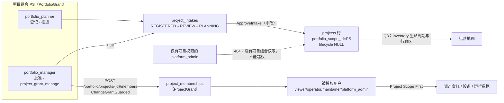

# Q2 正式项目可见性与授权初始化闭环：报告

> 分支 `feature/crane-dev-single-origin`，基线 `2b5bdcf`。开始时核对过远端 HEAD 仍为 `2b5bdcf`，没有他人新提交；Q1 的 CI run `42812630444` 当时正在运行。
> 本轮未改 main、服务器、数据库、Keycloak 和设备控制，**没有新增迁移**，也没有新增全局管理员绕过。

## 1. 数据与权限流转

规则：

- **批准不授权。** 只有本项目组合的 `portfolio_manager` 能给本项目组合批准生成的正式项目配置 ProjectGrant。
- **项目组合权限不带来项目权限。** `portfolio_manager` 自身仍然不能读写项目资产。
- **项目权限不带来项目组合权限。** 只有项目权限的 `platform_admin` 看不到正式项目，也不能授权。

## 2. 源码事实与设计决定

| 项 | 现状 | 本轮决定 |
| --- | --- | --- |
| 正式项目查询 | 不存在 | 新增 `GET /api/v1/portfolio/projects`（只列调用者所属项目组合的正式项目）和 `/{id}`。数据直接来自 `projects JOIN project_intakes`（`formal_project_id`、状态 APPROVED、项目组合和租户一致），使用已有索引 `projects_portfolio_scope` 和 `project_intakes_formal_project`，不复制项目数据 |
| 授权能力 | 只有宿主机 `identity grant`；R4 设计稿写的是「仅 platform_admin」 | 新增**项目组合能力** `project_grant_manage`，只授予 `portfolio_manager`。理由：新项目在授权前没有任何人持有 ProjectGrant，用项目内的 platform_admin 来授权，既无法完成首次授权，也违反「platform_admin 不是全局管理员」原则。它不是项目能力，不能读写资产。R4 的全局用户目录和管理员工作台仍按原计划另做 |
| 授权实现 | `identity.ChangeGrant` 负责事务和审计 | 抽出 `writeGrant`，让 ChangeGrant（宿主机工具）和新增的 `ChangeGrantGuarded`（HTTP）共用**同一套**写入和审计逻辑（`project_role_changed`，`granted:`/`revoked:` 前缀）。Guarded 额外做三件事：在同一事务里锁住项目行并重新校验项目组合与能力；校验目标用户必须存在、启用、且来自本平台 OIDC issuer；用 `expectedRole` 做并发保护 |
| 请求体 | — | 只接受 `{userId, role|null, expectedRole|null}`，严格解码，未知字段返回 422。项目、项目组合、租户和操作者全部从路径和数据库解析，不信任请求体 |
| 用户录入 | 没有用户目录 | 只接受精确的平台账号 ID，服务端确认；不提供搜索，失败只返回「账号不存在、已停用或不是本平台账号」，不泄露其他用户信息。不能给自己授权（防止经理自我提权） |
| `CreateIntake` 审计 | **缺失**：只写 `project_intakes`，没有审计事件（已确认） | 改为在同一事务里写入登记行和 `intake_created` 审计（带 request id），任一失败都整体回滚 |
| 迁移 | — | 不需要：`portfolio_scope_id`、`formal_project_id`、`project_memberships`、`audit_logs` 都已存在 |

接口错误码：

- 不存在、未批准、Inventory 项目或其他项目组合的项目：404。这类拒绝会写 `authorization_denied` 审计。
- 是成员但没有该能力：403。
- 非法用户、角色或字段：422。
- 并发冲突、重复提交、撤销不存在的成员：409。
- 数据库故障：503。

## 3. 前端

- 项目组合页新增「正式项目」页签，列出阶段、成员状态、地图状态，并标明是查看还是管理。
- 详情面板显示阶段、成员数、运营地图状态、当前用户的管理权限。经理可以看到成员列表，能调整角色、撤销，也能授予新权限：
  - 角色说明写清每个角色的项目内权限，例如项目管理员「不含设备控制」；
  - 改角色和撤销前都要确认；
  - 保存中禁止重复提交，失败时原位提示并保留输入；
  - 关闭面板、切换路由、关闭页面时有草稿保护。
- 授权成功后刷新正式项目列表、资产缓存、项目缓存和会话。
- 页面文字明确区分「项目组合权限」和「项目权限」。
- Q1 遗留问题修复：
  1. 规划者看不到「批准」按钮，显示「待项目组合经理批准」。按钮只是界面提示，服务端仍对规划者返回 403，已有测试证明。
  2. 「后续环节」改用 `/portfolio/projects` 的服务端结果。拿不到结果时显示「运营地图状态未知」，不再直接断言「未进入运营地图」。
- `GET /portfolio/scopes` 新增 `myRole` 字段，只用于界面判断。

## 4. 安全反证（真实 PostgreSQL + BFF，`portfolio_projects_http_test.go`，均已纳入 r2-db-test 必过门禁）

| # | 要求 | 证据 | 结果 |
| --- | --- | --- | --- |
| 1 | 经理只能管理本项目组合的项目 | Refusals：PS-B 经理操作 FP-A、PS-A 经理操作 FP-B 都返回 404；Visibility：列表只含本项目组合 | PASS |
| 2 | 没有项目组合权限的 platform_admin 不能越权 | 列表为空 `[]`，详情、成员、授权都返回 404 | PASS |
| 3 | 规划者不能管理 | 读成员和授权都返回 403；界面没有入口 | PASS |
| 4 | 非法用户、角色、跨范围项目被拒绝且无写入 | 以下 18 种拒绝前后，成员表与 `project_role_changed` 审计数完全一致：未知、停用、外部 issuer、无 issuer 的用户；给自己授权；`portfolio_manager`/`admin` 角色；非法 ID；body 带 projectId；撤销不存在的成员；过期 expectedRole；缺 CSRF；未批准项目；Inventory 项目 | PASS |
| 5 | 首次授权后能访问 | Lifecycle：授予 platform_admin 后，会话中出现 FP-A，能创建资产 `Q2-CRN-1`（201）并在列表中看到 | PASS |
| 6 | 撤销后旧会话失效 | 同一 cookie 在撤销后：列表看不到、直接读资产返回 404、会话中不再有该项目 | PASS |
| 7 | 不影响其他项目和账号 | 授权后 FP-B 及其他用户的成员关系数为 0 | PASS |
| 8 | 审计准确，失败不留部分数据 | 3 次成功变更恰好对应 3 条审计，actor、project、request_id 都正确，result 精确到 `granted:user-new:platform_admin`、`granted:user-new:viewer`、`revoked:user-new`；拒绝的请求写 `authorization_denied`；登记创建有 `intake_created` | PASS |
| 9 | 项目组合权限不能直接获得资产或设备权限 | 经理读不到 FP-A 的资产，创建资产失败；能力组合测试确认 portfolio_manager 不含 read、watch、asset_master_write | PASS |
| 10 | 重复、并发、乱序 | 6 个并发首次授权恰好 1 个返回 200、5 个返回 409，只有 1 条审计；原样重复提交返回 409；先撤销、后到的旧请求返回 409，授权不会被恢复；连续跑 5 次稳定 | PASS |

另有 `TestLockManageableProjectRechecksScopeAndCapability`：事务内的重新校验能独立拒绝以下情况——规划者、已停用的经理、没有成员资格、项目组合不匹配、未批准、未知项目。

**变异验证**（改坏代码后测试必须失败，验证完已复原）：

1. 去掉 expectedRole 检查后，Refusals 和 Concurrency 失败。
2. 让规划者获得 grant_manage 后，Refusals 报「planner: want 403, got 200」。
3. 让事务内能力校验永远通过后，锁定测试报 3 项失败。
4. 去掉事务内的项目组合比对后，锁定测试报「scope mismatch」失败。

## 5. 浏览器验证

| 套件 | 内容 | 结果 |
| --- | --- | --- |
| `tests/e2e/premium/portfolio-grants.spec.ts`（模拟 API，执行服务端规则） | 经理：从登记行进入 → 无成员 → 授予 → 调整角色 → 撤销，请求体包含 expectedRole；422、409、503 原位提示并保留输入；不能给自己授权；保存中只发 1 次；规划者只读；空状态、503、「运营地图状态未知」；三档分辨率 | 7/7 PASS |
| `tests/e2e/premium/portfolio-intake.spec.ts`（Q1，已按新规则更新） | 规划者没有批准按钮，强行调用返回 403 | 8/8 PASS |
| `tests/e2e/b4/portfolio-grants.spec.ts`（**真实 Keycloak + PG**） | 规划者登记 → 经理批准 → 经理在浏览器授权 b4-grantee → b4-grantee 用资产中心界面在该项目创建资产 → 经理读不到该资产 → 浏览器撤销 → b4-grantee 的旧会话读不到、写不进、会话中也没有该项目；反证：规划者无入口且返回 403，只有项目权限的 b4-admin 列表为空、详情和授权都返回 404 | **NOT_RUN（本地没有 Docker）**，由 CI 的 b4-business-acceptance 执行 |

截图在 `docs/04-前端与可视化/evidence/q2-grants/`：

- `1-formal-no-members`、`2-granted`、`3-errors`、`4-planner-readonly`、`5-formal-503`
- 分辨率：`6-panel-1280x720`、`6-panel-1366x768`、`6-panel-1920x1080`

三档分辨率下，授予按钮和撤销按钮都在视口内且可用，没有横向溢出。

## 6. 回归

- Go：`internal/identity`、`portfolio`、`webauth`、`asset`、`contracts`，以及 `services/cloud-api/internal/app` 全包通过；vet、gofmt、astguard 通过；codegen `--check` 通过。
- 前端：vitest 25 个文件、209 项通过；typecheck 和 lint 通过。
- 浏览器 premium 全套件：36 + 39 + 12 + 12 全部通过，含 1 项既有 skip。
- 契约测试 63/63。

## 7. 修改文件

- 后端：
  - `internal/identity/{capability.go, repository.go, capability_test.go}`
  - `internal/portfolio/{portfolio.go, portfolio_test.go}`
  - `internal/webauth/manager.go`（新增 `Issuer()`）
  - `services/cloud-api/internal/app/{portfolio_api.go, portfolio_projects_api.go（新）, portfolio_projects_http_test.go（新）, portfolio_routes_test.go}`
- 契约：`contracts/model.json` 新增 PortfolioProject、ProjectMember、ProjectGrantChange，以及 PortfolioScope.myRole；`tools/codegen/openapi.mjs` 新增 4 条路由；以及生成的 Go、TS、Schema、OpenAPI 文件。
- 前端：
  - `apps/web-console/src/cloud/{portfolio.ts, intake.ts, project-grants.ts（新）}`
  - `src/components/FormalProjectPanel.vue`（新）
  - `src/views/PortfolioWorkspace.vue`
  - `tests/{intake.test.ts, project-grants.test.ts（新）}`
- 测试与夹具：
  - `tests/e2e/premium/{portfolio-grants.spec.ts（新）, portfolio-intake.spec.ts}`
  - `tests/e2e/b4/portfolio-grants.spec.ts`（新）
  - `tests/integration/a1fixture/main.go`（新增匿名账号 b4-grantee，无任何授权）
  - `tools/r2-b2-test.mjs`、`tests/contract/r2-db-gate.test.mjs`

## 8. 遗留问题

| 级别 | 问题 |
| --- | --- |
| P0 | 无 |
| P1 | 真实 Keycloak 浏览器闭环（b4 portfolio-grants 2 条）在本地是 NOT_RUN，以 CI 结果为准 |
| P1 | 正式项目仍不能进入运营地图（没有 Inventory 生命周期和行政区），属于 Q3 |
| P1 | 一个项目组合只有一名经理时，经理无法给自己授权，需要第二名经理或宿主机工具，这是有意设计。是否需要「项目组合负责人」类角色，待产品决定 |
| P2 | 没有成员变更历史的界面，审计只在 `audit_logs` 中（R4 审计中心） |
| P2 | 被授权用户需要刷新页面才能在顶部范围选择器看到新项目（会话在页面加载时获取）；服务端权限是即时生效的 |
| P2 | 正式项目列表和成员列表没有分页 |
| P2 | 被授权账号必须至少登录过一次本平台（users 表有记录），否则返回 422；还没有邀请流程 |
