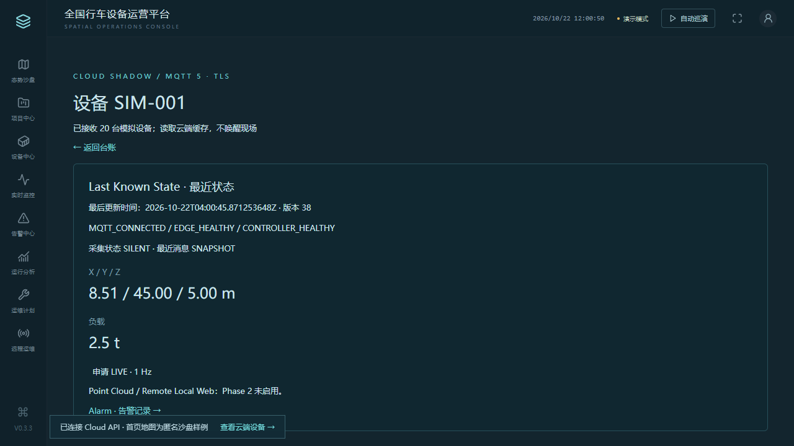

# Phase 0 验收报告

验收日期：2026-10-22。范围：企业工程基线、匿名模拟云边链路、已有沙盘迁移。首次提交阶段按用户要求不创建 PR，不合并 main。

PHASE0_STATUS=PASS
REPO_STRUCTURE=PASS
DOCS_BASELINE=PASS
CONTRACTS=PASS
CI=PASS
DEV_COMPOSE=PASS
DEVICE_SIMULATOR_20=PASS
SHADOW_MINIMAL=PASS
SECRETS_SCAN=PASS

## 仓库与版本

- 仓库：https://github.com/guolichen007/crane-operations-platform
- 分支：feature/phase0-enterprise-bootstrap
- 受测代码：7564d38e6218da663cd6f6bcc21c981d904a8036
- main 仅工程基线：2ae0686c988d1c137f3ded6e70b5939c31276773
- PR_URL=NOT_CREATED_BY_REQUEST
- 最终验收资料提交 SHA 见 Git 历史与最终文字回复；报告不自引用其所属提交 SHA。

## 本机实际结果

| 检查 | 结果与证据 |
|---|---|
| bootstrap | PASS，npm ci / Go 依赖 / 随机开发凭据和 CA、20 台独立证书生成 |
| lint | PASS，协议无漂移、go vet、staticcheck、vue-tsc、ESLint |
| test | PASS，8 个 Go 测试、23 个 Web 单元测试、3 个契约测试 |
| build | PASS，Go 全包、Web 与单文件 HTML |
| Web E2E | PASS，26 项完整分辨率浏览器回归；另 3 项 CI 像素密度验证通过 |
| dev-up | PASS，6 个服务真实运行；Windows 使用本机预编译与流式镜像打包 |
| integration-test | PASS，13 条真实链路证据见 evidence/phase0-integration.json |
| PostgreSQL | PASS，空库 Goose 迁移至 version 1，20 个 device_shadow；Cloud 重启后恢复 |
| MQTT/TLS/ACL | PASS，20 个独立身份；设备越权发布、设备写 watch 命令被拒绝 |
| Secret | PASS，gitleaks v8.30.1 本地扫描约 25.88MB，no leaks found；公开客户名检查通过 |
| 依赖 | PASS，govulncheck v1.9.0 未发现漏洞；CI npm audit/Trivy 见下 |
| Offline HTML | PASS，file:// 浏览器打开，34 个省级数量标签，外部网络请求 0 |
| dev-down | PASS，仅停止并移除本项目容器，保留开发数据卷 |

## 集成覆盖

1 台 Shadow 打通后扩展到 20 个独立证书连接。读取 Cloud 缓存、持久数据库并显示设备详情；拒绝未授权 API。WATCH/LIVE 1Hz、5 个租约聚合、续租/释放/grace、无人续租 TTL 到期回 SILENT 均验证。SILENT 告警立即入库，重复 message_id 去重；旧序号不能覆盖。SIGKILL 模拟断线触发 LWT，重连新 boot 恢复；Cloud 重启重建持久 Shadow 缓存。

## CI

最终受测代码 7564d38e6218da663cd6f6bcc21c981d904a8036 的六项 CI 全部 PASS：repository-contract、backend、edge、frontend、integration、security。

运行：https://github.com/guolichen007/crane-operations-platform/actions/runs/39722512861

包括 Go race/vet/staticcheck、3 项标准契约测试、前端类型与规则/23 单测/构建/26 项浏览器回归、20 台真实模拟链路、gitleaks/npm audit/govulncheck/Trivy 文件和镜像扫描。摘要见 evidence/ci-summary.json。

最后验收资料提交只更新本报告、证据和第三方声明，以 [skip ci] 避免对相同代码重复整套测试；最终 HEAD SHA 见 Git 与文字回复。受测代码与验收资料版本明确区分。

## 实现边界与已知限制

- Phase 0 是可运行工程基线和开发 POC，不是现场投产版本。数据匿名且全部模拟，无 PLC 或真实远控。
- 开发身份仅一个本地管理员，角色策略有测试；生产身份、租户隔离、证书吊销、限流和部署加固待后续。
- LIVE 租约内存 POC，live_sessions 表预留但未持久化；Cloud 重启依靠 Edge TTL 关闭，用户重新申请。
- MQTT 进程重启持久消费状态、独立应用 ACK、回执对账、全量故障注入与小时/日统计需 Phase 1 加固。优雅退出不触发 LWT，完整心跳过期判定尚未实现。
- 5 个租约聚合已验证，不等于完成 20 用户/5 台 LIVE 的容量压测。CI 无 GPU 使用 0.25 像素密度，完整分辨率视觉回归已在本机验证。
- Gateway 业务 403 / Remote API 501，点云只有协议与队列原语，不提供完整远程 Web 或 ROS 传输。
- 开发 Compose 有读取 bind keys 的 root 例外，只绑定本机端口；不能直接作为生产部署。地图合规和根商业许可证仍需所有者确认。
- 原客户版及旧 Git 历史仅本地保留，未推送。只能推送当前公共工程分支，禁止 push --all/--mirror。

## 人工审查后建议

先审查协议、安全边界与当前限制，再决定 PR/merge。若进入 Phase 1，优先生产身份、持久会话与 ACK/重连对账，然后验收 20 静默、5 LIVE、5 浏览器同设备和 20 用户负载。当前停止在 Phase 0，不接真实现场。

契约另经 Swagger Parser 与 AsyncAPI Parser 完整解析；AsyncAPI 3.0 的安全引用与离线Schema互操作已修正，旧安全写法作为反例被拒绝。
