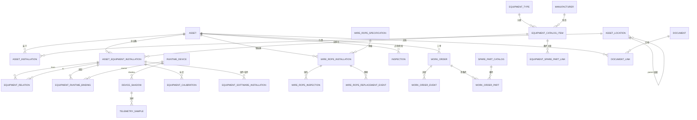

# Phase1-A1.1-R2 行车数字资产图谱（Crane Digital Asset Graph）

> 本文档是 R2 第三轮架构升级的核心：把数据模型从「资产台账 + 钢丝绳 + 部件」升级为**行车数字资产图谱**。核心抽象：**Asset（业务资产）→ Equipment（设备）→ Runtime Binding（运行绑定）→ Telemetry（遥测）** 三层不混为同一实体。
>
> 关联文档：《设备与运行数据边界》《自动化设备分类与字段模型》《成熟平台对标研究》。
> 设计版本：DESIGN_VERSION=3（第三轮）。DESIGN_ONLY=YES，本轮不编码。

---

## 1. 为什么需要"图谱"而不是"台账"

我们的对象不是「一台行车 + 一根钢丝绳 + 几个部件」，而是**一整套自动化行车系统**。成熟工业平台（ThingsBoard、AWS SiteWise、OPC UA for Machinery、IDTA AAS）无一例外把「业务资产」「组成它的设备」「产生遥测的连接」分层建模。图谱的本质是：**模型里的对象知道自己是什么、属于谁、跟谁有关系、数据从哪里来**。

## 2. 三层核心模型

```
Asset（业务资产，可标识但不一定联网）
   │  belongs / contains
   ▼
Equipment Installation（可维护、可更换、可配置的实际设备）
   │  bound to
   ▼
Runtime Binding（真实运行连接，DEPLOYMENT_OWNED）
   │  produces
   ▼
Telemetry（遥测，TELEMETRY_OWNED，不可 UI 伪造）
```

| 层 | 是什么 | 例子 | 业务可编辑 | 谁拥有 |
|----|--------|------|-----------|--------|
| **Asset** | 业务资产：CRANE / SITE / RUNWAY | `CRANE-QD-001` | 展示元数据 | BUSINESS_OWNED |
| **Equipment** | 可维护/可更换/可配置设备 | `EQ-LIDAR-001`（图达通灵雀W）、PLC、VFD、Camera、IPC、Switch | 品牌/型号/序列号/安装日期/位置/固件版本/备注 | BUSINESS_OWNED |
| **Runtime Binding** | 真实连接 | `EDGE-001` + `topic /perception/lidar/front` + `driver=innovusion_xxx` | **只读** | DEPLOYMENT_OWNED |
| **Telemetry** | 遥测 | 在线状态、载荷、运行时间、健康 | **不可伪造** | TELEMETRY_OWNED |

关键：业务页面**可以编辑**品牌/型号/序列号/安装/位置/固件/备注，但**不能编辑** MQTT credential / device certificate / REAL identity / runtime provenance / 安全认证——这些继续 DEPLOYMENT_OWNED，不破坏现有安全体系。

## 3. 命名变更：Component → Equipment

R2 第二版蓝图里的 `component_catalog_items / asset_component_installations` 概念太小——一台激光雷达、工业相机、PLC、工控机、交换机在运营人员心中是**设备资产**，不是"机械零部件"。正式改为：

| 旧命名（废弃） | 新命名 | 语义 |
|---------------|--------|------|
| component_catalog_items | `equipment_catalog_items` | 设备目录条目 |
| asset_component_installations | `asset_equipment_installations` | 设备安装实例 |
| （无） | `equipment_types` | 设备类型（taxonomy） |
| （无） | `equipment_relations` | 设备关系图 |

钢丝绳因生命周期与检查规则特殊，**继续保留专用四表**（specification/installation/inspection/replacement_event），不并入 generic Equipment；但钢丝绳可通过 `equipment_relations` 关联 DRUM/HOIST。

> **R2-0 冻结**：`component_*` 命名已全部废弃，最终统一 `equipment_*`；新 migration 禁止创建 `component_catalog_items` / `asset_component_installations`；API 一律 `/equipment`，capability 一律 `equipment_condition_write`；`component` 仅允许出现在外部标准描述/UI 文案的"组成部件"语境。

## 4. 概念层级（完整实例的骨架）

```
厂区 Site
└── 车间 Plant/Workshop
    └── 跨区/轨道 Bay/Runway
        └── 行车 CRANE-QD-001 (Asset)
            ├── 机械系统
            │   ├── 起升机构 HOIST（HOIST_MOTOR → HOIST_REDUCER → DRUM → WIRE_ROPE → HOOK/GRAB）
            │   ├── 大车机构 GANTRY（GANTRY_MOTOR_FL/FR/RL/RR）
            │   ├── 小车机构 TROLLEY（TROLLEY_MOTOR）
            │   ├── 电机 MOTOR
            │   ├── 减速器 REDUCER
            │   ├── 制动器 BRAKE
            │   ├── 卷筒 DRUM
            │   ├── 钢丝绳 WIRE_ROPE
            │   └── 抓斗/吊钩 GRAB/HOOK
            ├── 电气控制 CONTROL
            │   ├── PLC / PLC I/O / SAFETY_PLC
            │   ├── 变频器 VFD / SERVO_DRIVE
            │   ├── 接触器 CONTACTOR / 安全继电器 RELAY
            │   ├── 电源 POWER_SUPPLY
            │   └── 控制柜 CONTROL_CABINET
            ├── 感知系统 PERCEPTION
            │   ├── 3D LiDAR / 2D LiDAR
            │   ├── 相机 CAMERA（RGB/DEPTH/STEREO/THERMAL）
            │   ├── 编码器 ENCODER / 拉绳编码器 ROPE_ENCODER
            │   ├── 称重传感器 LOAD_CELL
            │   ├── IMU
            │   ├── 限位开关 LIMIT_SWITCH
            │   └── 防碰撞传感器 ANTI_COLLISION_SENSOR
            ├── 计算系统 COMPUTE
            │   ├── 工控机 INDUSTRIAL_PC
            │   ├── Edge Runtime EDGE_GATEWAY
            │   └── GPU / SSD
            ├── 网络系统 NETWORK
            │   ├── 工业交换机 INDUSTRIAL_SWITCH
            │   ├── PoE 交换机 POE_SWITCH
            │   ├── 网关 GATEWAY
            │   └── 网络链路 NETWORK_LINK
            ├── 软件与固件 SOFTWARE
            │   ├── PLC 程序版本
            │   ├── LiDAR Firmware
            │   ├── Camera Firmware
            │   ├── Edge 软件版本
            │   └── 算法版本
            └── 运行数据 TELEMETRY
                ├── 在线状态 / 运行模式
                ├── 工作时间 / 工作循环 / 载荷
                ├── 电机启动次数 / 急停 / 故障 / 健康状态
```

---

## 5. 四维状态（防止误导用户）

不一个 `status` 包打天下，拆四种：

| 维度 | 值 | 谁维护 |
|------|-----|--------|
| **Lifecycle**（生命周期） | INSTALLED / REMOVED / RETIRED | 业务（安装/退役动作） |
| **Administrative State**（行政状态） | IN_SERVICE / MAINTENANCE / OUT_OF_SERVICE / FAULT_REPORTED | 业务（人工维护） |
| **Connectivity**（连接） | ONLINE / OFFLINE / UNKNOWN / UNBOUND | **仅 Runtime/Telemetry** |
| **Condition**（健康） | NORMAL / WARNING / ALARM / UNKNOWN（含 `source` + `observed_at`） | **仅带来源的判定** |

例：PLC 显示「在役 · ONLINE · WARNING」；一台未接实时状态的雷达显示「在役 · 实时状态：未接入 · 健康状态：未知」——**绝不为了界面好看填绿色"正常"**。Connectivity 不得人工填写 ONLINE；没有 runtime binding 显示「实时状态未接入」。Condition 无可信数据 = UNKNOWN。

## 6. equipment_relations（关系图，非仅父子）

关系类型（同 asset 内校验，除非未来明确支持跨资产）：

`CONTAINS / MOUNTED_ON / DRIVES / CONTROLS / SENSES / MONITORS / POWERED_BY / NETWORKED_TO / PROTECTS / BACKS_UP`

例：
- `PLC CONTROLS HOIST_VFD`；`HOIST_VFD DRIVES HOIST_MOTOR`；`HOIST_MOTOR DRIVES HOIST_REDUCER` → `DRUM` → `WIRE_ROPE_INSTALLATION`
- `IPC NETWORKED_TO LIDAR`；`POE_SWITCH NETWORKED_TO CAMERA`；`CAMERA MOUNTED_ON TROLLEY`；`LIDAR SENSES WORK_AREA`

点击「主起升变频器」→ 看到：ABB ACS880 · 37kW · Firmware xxx · 驱动主起升电机 · 当前 ONLINE · 最近故障 Overcurrent · 关联工单 WO-xxx。

---

## 7. 实体关系 ERD（概念级）



> 关键不变量：Project Scope 恒从 `任一对象 → asset → project` 解析；同 asset 关系校验；Runtime identity/credential/sourceMode 在 DEPLOYMENT_OWNED 侧，业务表只留只读绑定。

---

## 8. 完整实例：一台自动行车（CRANE-QD-001）

> 说明这是"某台自动行车"的完整实例化，覆盖负责人要求的设备清单，并逐项说明：DB 实体、页面显示、Three.js 映射、实时状态来源、维保关联。

### 8.1 设备清单与实体

| 业务编号 asset_code | 设备类型 | 型号(示例) | 序列号(示例) | 归属机构 | Runtime 绑定 | 实时状态来源 |
|---|---|---|---|---|---|---|
| EQ-QD001-LIDAR-01 | LIDAR_3D | 图达通 灵雀W | SN-L01 | 感知系统 | EDGE-001 /perception/lidar/front | Telemetry |
| EQ-QD001-LIDAR-02 | LIDAR_3D | 图达通 灵雀W | SN-L02 | 感知系统 | EDGE-001 /perception/lidar/rear | Telemetry |
| EQ-QD001-CAM-01 | CAMERA_RGB | 海康 MV-CE | SN-C01 | 感知系统 | EDGE-001 /perception/cam/front | Telemetry |
| EQ-QD001-CAM-02 | CAMERA_THERMAL | 海康 | SN-C02 | 感知系统 | 未绑定 | **未接入** |
| EQ-QD001-PLC | PLC | 西门子 S7-1500 | SN-PLC | 电气控制 | EDGE-001 /control/plc | Telemetry |
| EQ-QD001-VFD-HOIST | VFD | ABB ACS880 37kW | SN-V1 | 起升机构 | EDGE-001 /drive/hoist | Telemetry |
| EQ-QD001-VFD-GANTRY | VFD | ABB ACS580 | SN-V2 | 大车机构 | EDGE-001 /drive/gantry | Telemetry |
| EQ-QD001-MOT-HOIST | MOTOR | — 37kW | SN-M1 | 起升机构 | （经 VFD 间接） | 间接/Condition |
| EQ-QD001-MOT-TROLLEY | MOTOR | — | SN-M2 | 小车机构 | （经 VFD） | 间接 |
| EQ-QD001-MOT-G1/G2 | MOTOR | — | SN-M3/M4 | 大车机构 | （经 VFD） | 间接 |
| EQ-QD001-BRAKE-HOIST | BRAKE | — | SN-B1 | 起升机构 | — | Condition |
| EQ-QD001-BRAKE-TROLLEY | BRAKE | — | SN-B2 | 小车机构 | — | Condition |
| EQ-QD001-IPC | INDUSTRIAL_PC | 研华 UNO | SN-IPC | 计算系统 | EDGE-001 宿主 | Telemetry |
| EQ-QD001-SW | POE_SWITCH | — 8 口 PoE | SN-SW | 网络系统 | — | — |
| EQ-QD001-LOADCELL | LOAD_CELL | — 30t | SN-LC | 感知系统 | EDGE-001 /sensor/load | Telemetry |
| EQ-QD001-ENC | ENCODER | — 拉绳 | SN-EN | 感知系统 | EDGE-001 /sensor/rope | Telemetry |
| EQ-QD001-LS-* | LIMIT_SWITCH | — ×6 | — | 安全 | EDGE-001 /safety/* | Telemetry |
| ROPE-01/02 | WIRE_ROPE | 6×36WS 钢丝绳 | — | 起升机构 | —（专用四表） | Inspection/Condition |

### 8.2 页面如何显示

- **行车台账**：`CRANE-QD-001`（asset_code）+ 品牌/型号/吨位/跨度 + 状态（Lifecycle/Administrative）+ 连接（Connectivity）+ 位置（Bay/Runway）。
- **设备台账**（新增）：统一列「设备编号/设备类型/所属行车/位置/厂商/品牌/型号/序列号/安装日期/行政状态/实时连接/健康/固件版本/最近检查/下次维护」，支持按 LiDAR/Camera/PLC/IPC/Switch/VFD/Motor/Brake/Sensor 统一筛选。
- **行车详情 /assets/QD-001（Asset 360）** Tabs：概览 / 实时运行 / 数字孪生 / 系统拓扑 / 部署位置 / 设备 / 钢丝绳 / 告警 / 点检 / 维保 / 合规 / 软件版本 / 标定 / 资料 / 变更历史。
- **点击设备（如 LIDAR-01）**：右侧 Inspector 显示 厂商图达通 / 品牌灵雀W / SN / Firmware / 安装时间 / 安装位姿（x,y,z,roll,pitch,yaw + pose_source）/ 标定状态 / 实时连接 / 最近故障 / 关联工单 / 相关文档。

### 8.3 Three.js 如何映射（Physical Semantic Twin）

```
CraneTwinRoot（保留现有 runway/gantry/trolley/hoist/grab 四轴 hierarchy）
├── RUNWAY
├── GANTRY（GANTRY_MOTOR_FL/FR/RL/RR 语义节点）
├── TROLLEY（TROLLEY_MOTOR、CAMERA_TROLLEY）
├── HOIST（HOIST_MOTOR、HOIST_VFD、HOIST_BRAKE、HOIST_REDUCER、DRUM、WIRE_ROPE_1/2）
├── CONTROL_CABINET（PLC、IO_MODULE、INDUSTRIAL_PC）
└── SENSOR_SYSTEM（LIDAR_FRONT、CAMERA_FRONT、IMU、LOAD_SENSOR）
```

- 映射链：`three node → semantic_slot → asset_equipment_installations`（**不直接绑定 DB installation ID**）。
- 点击 LIDAR_FRONT → Raycaster → semantic_slot → 设备 → Inspector（右侧联动真实设备）。
- **传感器可视化**：LiDAR 显示 mount pose + 水平/垂直 FOV + 测距锥体/frustum；Camera 显示 frustum；仅 `pose_source ∈ {CALIBRATED, SURVEY}` 显示"已标定安装位姿"，MANUAL 标注"示意"。
- 模型准确度：GENERIC / PARAMETRIC / CATALOG / AS_BUILT；仅真实 CAD/测量可标 AS_BUILT。
- **不做自动安全结论**：断丝数量不自动红、直径磨损不自动判报废色；状态仅由带 source 的 condition_state 驱动。

### 8.4 系统拓扑（2D graph，不塞 Three.js）

```
PLC ──CONTROLS── VFD_HOIST ──DRIVES── MOTOR_HOIST ──DRIVES── REDUCER ── DRUM ── WIRE_ROPE
PLC ──CONTROLS── VFD_GANTRY ──DRIVES── MOTOR_G1/G2
IPC ──NETWORKED_TO── POE_SWITCH ──NETWORKED_TO── LIDAR_01/02, CAM_01/02, PLC
POE_SWITCH ──POWERED_BY── POWER_SUPPLY
LOAD_CELL ──MONITORS── HOIST
```

资产详情「系统拓扑」Tab 用 2D 图呈现 Control / Network / Power / Sensor 关系；Three.js 只做物理孪生。

### 8.5 实时状态从哪里来

- `ONLINE`/`RUN`/`FAULT`/载荷/运行时间/工作循环/电机启动次数/急停次数/制动循环/行程距离 → 全部来自 Runtime Binding → Telemetry，业务 UI 只读。
- 未绑定（如 CAM-02）→「实时状态未接入」+ 健康 UNKNOWN，不填绿色"正常"。
- 运行数据 schema（承载能力先做，无真实源 = UNAVAILABLE，不 Demo fill）：`operating_mode / running_hours / hoist_running_hours / work_cycles / lift_count / current_load / maximum_load / overload_count / motor_starts / emergency_stop_count / brake_cycles / travel_distance_x/y / hoist_distance_z / fault_count / availability`。

### 8.6 维保如何关联

- 点检/检验记录 `inspections`（asset_id NOT NULL，可关联 equipment/wire_rope installation，子对象必须同 asset）。
- 工单 `work_orders`（关联 asset/equipment/wire rope），状态机流转，已完成禁删。
- 更换设备：工单 → `work_order_parts`（备件）→ `replacement_events`（新装/旧拆）。
- 例：更换 HOIST_BRAKE → 工单 WO-xxx 用备件 "Brake Type XYZ ×1" → `replacement_events` 记录 old→new → 旧件 REMOVED、新件 ACTIVE。

---

## 9. 与既有安全体系的边界（重申）

- Asset/Equipment 业务元数据可编辑；Runtime identity/credential/sourceMode/MQTT/certificate 仍 DEPLOYMENT_OWNED。
- 网络参数（MAC/接口/网段/管理地址）可保存但归 DEPLOYMENT_OWNED；password/SNMP secret/PLC password/camera credential **永不进入业务库**。
- 不接真实 PLC、不实现真实远控、不开公网 Edge 管理端口；A2 前不做远程控制、设备 Enrollment、公网 MQTT 管理。

